# PotentialSuite Manual

*Eleven free plugins for Akai MPC standalone hardware, by PotentialBreaks.*

*Edition 1 · November 2026*

## About this manual

The **user guide** comes first: what each plugin does, how to install and load them, and how they work together, with the preset chains and the order to load them in. The **developer reference** is at the back: how the plugins are built, their parameters and file formats, and how to build, test and release one.

Every plugin also carries its own short manual on the MPC's screen: open the plugin and tap **MANUAL**.

The newest copy of this manual is at [github.com/PotentialBreakfast/potential-plugins](https://github.com/PotentialBreakfast/potential-plugins).

## Contents

- [Part 1: User guide](#part-1-user-guide)
  - [1. The suite at a glance](#1-the-suite-at-a-glance)
  - [2. Getting started](#2-getting-started)
  - [3. What every plugin shares](#3-what-every-plugin-shares)
  - [4. The instruments](#4-the-instruments)
  - [5. The effects](#5-the-effects)
  - [6. Working together: FX chains](#6-working-together-fx-chains)
  - [7. USER presets](#7-user-presets)
  - [8. Troubleshooting](#8-troubleshooting)
  - [9. Compatibility and CPU](#9-compatibility-and-cpu)
- [Part 2: Developer reference](#part-2-developer-reference)
  - [10. How a plugin is put together](#10-how-a-plugin-is-put-together)
  - [11. The engine interface](#11-the-engine-interface)
  - [12. Parameters](#12-parameters)
  - [13. Layout and looks](#13-layout-and-looks)
  - [14. Presets and USER slots](#14-presets-and-user-slots)
  - [15. Files on the MPC](#15-files-on-the-mpc)
  - [16. Building, testing and releasing](#16-building-testing-and-releasing)
  - [17. Credits and licences](#17-credits-and-licences)
- [Appendix A: Parameter reference](#appendix-a-parameter-reference)
  - [PotentialBreaks](#potentialbreaks)
  - [PotentialWax](#potentialwax)
  - [PotentialCrates](#potentialcrates)
  - [PotentialKits](#potentialkits)
  - [Potential1200](#potential1200)
  - [PotentialNoise](#potentialnoise)
  - [PotentialPatina](#potentialpatina)
  - [PotentialPunch](#potentialpunch)
  - [PotentialHeat](#potentialheat)
  - [PotentialGrit](#potentialgrit)
  - [PotentialBleed](#potentialbleed)
  - [PotentialWarp](#potentialwarp)

> A typeset copy of this manual: [PotentialSuite-Manual.pdf](PotentialSuite-Manual.pdf).

# Part 1: User guide

## 1. The suite at a glance

PotentialSuite is twelve plugins that run inside the MPC like its own instruments and effects. Each has its own touchscreen pages, works with the Q-Links and is saved with your project. No computer is needed while you play.

| Plugin | Loads as | What it is |
|---|---|---|
| **PotentialBreaks** | Instrument | Drum-break slicer: a random break from your own library on 16 pads, chopped and matched to your tempo |
| **PotentialWax** | Instrument | Melodic sampler: songs and loops on 16 pads, with tempo and key matched |
| **PotentialCrates** | Instrument | Record digger: finds records on Discogs and streams one into your track (needs a network connection) |
| **PotentialKits** | Instrument | Drum-kit builder: 16 sounds from your own sample folders, with kit styles, ROLL, and pitch, decay and choke per pad |
| **Potential1200** | Instrument | 12-bit drum sampler in the late-80s style: 8 faders and 8 pads, one-shots or a chopped break, drop-sample pitch and the classic filters |
| **PotentialNoise** | Instrument | Mixing tool: calibrated pink noise, test tones and a speaker check |
| **PotentialPatina** | Insert&nbsp;effect | Retro colour: vinyl and tape noise, wobble, drive, bit-crush, tone and room |
| **PotentialPunch** | Insert&nbsp;effect | Transient shaper: more or less attack and sustain |
| **PotentialHeat** | Insert&nbsp;effect | Soft clipper and bus saturator: warmth and loudness without harsh peaks |
| **PotentialGrit** | Insert&nbsp;effect | Seven lo-fi effects on pads: dust, crush, filter, kill EQ, echo, chop and ring |
| **PotentialBleed** | Insert&nbsp;effect | Ghost bleed: quiet synthetic residue behind each hit |
| **PotentialWarp** | Insert&nbsp;effect | Tempo-locked mangler: half time, tape stop, stutter, reverse and gates |

**Instruments** are loaded as a plugin program on a track, and you play them from the pads. **Insert effects** go on the inserts of a track, program, pad or bus; they are not in the instrument list.

### How they fit together

A beat usually moves through the suite in this order:

1. **Dig.** PotentialCrates finds a record. PotentialBreaks, PotentialWax, PotentialKits and Potential1200 dig through your own folders.
2. **Chop and build.** Breaks slices drums across the pads. Wax puts 16 cues on a song and matches its tempo and key. Kits builds a drum kit from your one-shots. Potential1200 plays one-shots or a break through a 12-bit, 26 kHz sampler with 8 faders.
3. **Colour.** Punch, Grit, Bleed and Patina shape and age the sound. Four ready-made chains set them up together (chapter 6).
4. **Glue and bend.** Heat warms a bus and catches peaks. Warp adds half time, tape stops and stutters in time.
5. **Balance.** PotentialNoise gives you a quick, neutral rough mix.

### Versions covered

| Plugin | Version | Type |
|---|---|---|
| **PotentialBreaks** | 1.8.0 | Instrument |
| **PotentialWax** | 1.9.0 | Instrument |
| **PotentialCrates** | 1.2.0 | Instrument |
| **PotentialKits** | 1.2.0 | Instrument |
| **Potential1200** | 1.0.2 | Instrument |
| **PotentialNoise** | 2.5.0 | Instrument |
| **PotentialPatina** | 1.6.0 | Insert effect |
| **PotentialPunch** | 1.6.0 | Insert effect |
| **PotentialHeat** | 1.5.0 | Insert effect |
| **PotentialGrit** | 1.2.0 | Insert effect |
| **PotentialBleed** | 1.2.0 | Insert effect |
| **PotentialWarp** | 1.4.0 | Insert effect |
| **MPC TOOLS** | 1.5.9 | Companion app (Windows, Mac) |

## 2. Getting started

### What you need

- A standalone MPC on **MPC OS 3.x**. On **MPC OS 3.10.1 or later** no modification is needed. On older MPC OS 3.x you need a first-generation MPC with the community plugin set-up from [Open MPC](https://open-mpc.github.io/).
- A drive the MPC can see (USB stick, SD card, SSD or the internal drive).
- MPC OS 2.x is not supported.

Chapter 9 lists the MPCs each plugin has been tested on.

### Install: three ways

Install each plugin one way only, or it shows up twice.

**A. By hand, on MPC OS 3.10.1 or later**

1. On the plugin's GitHub page, open **Releases** and download the file ending `-akai-vst2.zip`. Unzip it on your computer.
2. On the MPC, turn on **Preferences → Enhancements (Beta) → Enable Enhancements** and **External Plugin Support**.
3. Copy the plugin's folder (for example `PotentialBreaks - VST - PotentialPunch`) into a folder called **VST2 Plugins** at the top of a drive.
4. Restart the MPC. The plugin is under **External Plugins**.

**B. With MPC TOOLS (one tap, for MPCs with SSH access)**

[MPC TOOLS](https://github.com/PotentialBreakfast/mpc-tools) is a free second-screen app for Windows and Mac. Its **Plugins** tab lists every PotentialSuite plugin with the version on your MPC and the newest one. Tap **UPDATE ALL**, then **RESTART MPC APP**. Old copies go to a backup folder on the drive, and from MPC TOOLS 1.5.6 an update keeps the look you chose and your own files.

**C. With the Open MPC installer (older MPC OS 3.x, first-generation MPCs)**

Download the file ending `-mpc-armv7.zip` and leave it zipped. Open the free **MPC Plugin Installer** from [Open MPC](https://open-mpc.github.io/), connect, drop the zip in and press Install. Save your project first, because installing restarts the MPC app. Second-generation MPCs use the file ending `-mpc-aarch64.zip` with the Open MPC Plugin Manager.

### Loading a plugin

- **Breaks, Wax, Crates, Kits and Noise** are instruments. Make a plugin track or plugin program and pick the plugin from the instrument list.
- **Patina, Punch, Heat, Grit, Bleed and Warp** are insert effects. Open the inserts of a track, program, pad, bus or the master, tap an empty slot and pick the plugin from the effect list.

### Network safety

MPC TOOLS and the Open MPC installer reach the MPC over SSH. If your MPC has SSH switched on:

- Keep it on your home network. Don't join public or shared Wi-Fi with SSH on.
- Use an SSH key instead of a password where you can. The MPC TOOLS README explains how under "SSH key setup".

The plugins themselves never open a network connection, except PotentialCrates, which searches Discogs and streams audio.

## 3. What every plugin shares

### Pages

Each plugin has tabs along the top of its screen. The first is the main page. Every plugin also has:

- **MANUAL**: the plugin's own manual, a few pages of text with page buttons along the top.
- **SETTINGS** (SETUP in PotentialWax and Potential1200): the LOOK selector.
- **USER** (Patina, Punch, Heat, Grit and Bleed): eight preset slots of your own (chapter 7). PotentialKits has eight USER KITS on its SAVE page.

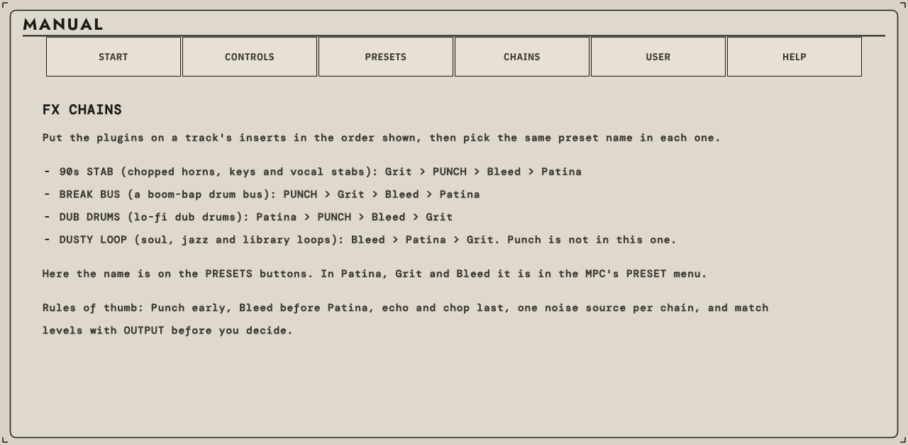

### Five looks

Every plugin comes in **Print Plate** (the default), **Night Rack**, **Colour Block**, **Vintage**: a late-80s drum machine with a warm grey panel, cream keys and an amber display, in the plugin's own colour, and **Hi-Fi** (PotentialBox's look: walnut cheeks, a brushed charcoal faceplate, domed knobs lit in the plugin's colour, moulded cream keys and green glass displays). Open **SETTINGS** and tap one of the LOOK keys. The new look shows the next time the plugin loads: take it off the track and add it again, or load your project again. The choice is kept on your MPC for every project. The sound and the controls are the same in all five. Vintage is Potential1200's own look, and its default.

### ROLL

**ROLL** is a dice button: one tap for a random setting that still sounds good. **MILD**, **MEDIUM** or **WILD** next to it sets how far it goes. Keep rolling until you like something, then fine-tune. In Breaks and Wax, ROLL also picks a random break or song. In Crates it picks the search filters. In Kits it rolls new samples, and at MEDIUM and WILD pitch and decay too. In Potential1200 it changes the unlocked pads' sounds and settings.

### Presets

Presets are in two places, depending on the plugin:

- **On the page**, as one-tap buttons: Punch and Heat (PRESETS), Patina (ERA), Warp (PATTERNS).
- **In the MPC's PRESET menu** at the top of the plugin screen: Patina, Grit, Bleed, Punch, Heat and Warp.

A preset is a starting point. Tweak from there.

### Q-Links

The main controls of each page are on the Q-Links. The plugin chapters list them.

### Saved with your project

Every setting is saved with your MPC project and comes back when you load it. Breaks, Wax and Potential1200 also remember the break or song, the chops and the cues. The look and the USER slots are not part of a project: they belong to the MPC.

## 4. The instruments

### 4.1 PotentialBreaks

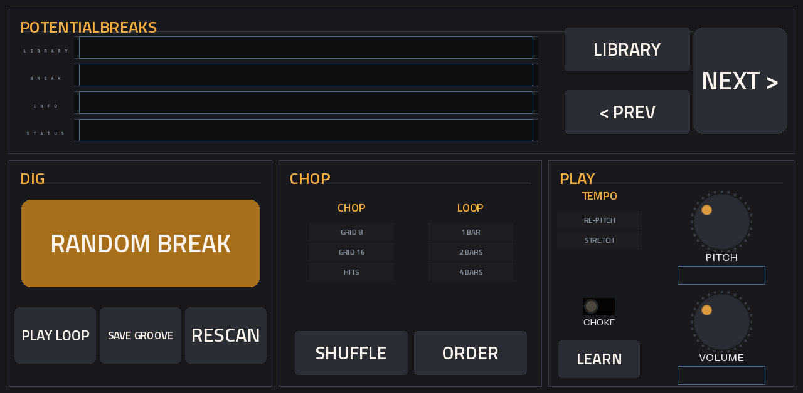

**Dig, chop, play.** One tap for a random drum break from your own library, sliced across 16 pads and matched to your project's tempo.

**Quick start**

1. Put your breaks (WAV, FLAC or MP3) in a folder called `DRUM BREAKS LIBRARY` at the top of a drive.
2. Load PotentialBreaks as a plugin instrument.
3. Tap **RANDOM BREAK**, or **ROLL** for a random break played a random way.
4. Play the pads.

**Controls**

| Control | What it does |
|---|---|
| **RANDOM BREAK** | Picks a break from your library |
| **PREV / NEXT** | Step through the breaks |
| **LIBRARY** | Switches folders. Every sub-folder is a library |
| **BROWSE** page | Lists 10 breaks at a time; tap the one you want. **RESCAN** after adding folders |
| **ROLL** | A random break and a random way to play it: chop, loop length, pad order and pitch |
| **CHOP** | 8 or 16 even slices on the beat (moved onto the nearest hit), or the 16 strongest hits |
| **TEMPO** | **Re-pitch** speeds the break up or down to your tempo, like an old sampler. **Stretch** keeps each slice at its own pitch and cuts it to length |
| **SHUFFLE / ORDER** | Re-deals the slices across the pads, or puts them back |
| **PLAY LOOP** | Plays the whole loop (so does the pad after pad 16) |
| **CHOKE, PITCH, VOLUME** | Pads cut each other off; ±12 semitones; level |
| **SAVE GROOVE** | Writes a MIDI file of the break's original slice order |
| **SAVE KIT** | Writes a real MPC drum program: each pad as a WAV, as you hear it, on pads A01 to A16, with the groove as a MIDI file. MPC OS 3.10.1 or later |
| **LEARN** | Sets which pad is pad 1 |

**Q-Links:** PITCH, VOLUME, CHOP, BARS, TEMPO and CHOKE.

**Where it finds your breaks**

1. A folder called `DRUM BREAKS LIBRARY` at the top of any drive.
2. Any folder at the top of a drive with "break" in its name.
3. Folders you list in `PotentialBreaks/folders.txt` on the breaks drive, one per line. The plugin creates this file the first time it runs.

**Good to know**

- Tempo comes from the file name when it has one (`Funky Drummer 101bpm.wav`, or `.mp3`). Otherwise it is measured, between 80 and 160 BPM, so a 70 BPM break may read as 140.
- Long tracks get a random 1, 2 or 4 bar loop cut from them, starting on a hit. Only the first 3 minutes of a file are used.
- Stretch mode does not time-stretch: at slower tempos you hear small gaps between hits, the classic chopped sound.
- 8 voices, 44.1 kHz playback.
- Kits are saved to `PotentialBreaks/Kits` on the breaks drive, grooves to the `PotentialBreaks` folder. To use your own programs folder, put its full path on the first line of `PotentialBreaks/kit-folder.txt`.

### 4.2 PotentialWax

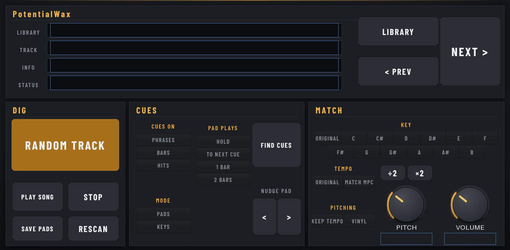

**Dig, flip, play.** A melodic sampler: pick a song from your own library, or let it dig one out, and it finds 16 cue points, works out the tempo and key, and matches them to your project.

**Quick start**

1. Put songs or loops (MP3, WAV or FLAC) in a folder called `MELODIC LIBRARY` at the top of a drive. Wax needs a folder of songs to work.
2. Load PotentialWax as a plugin instrument. Tap **RESCAN** on the BROWSE page after adding songs.
3. Tap **RANDOM TRACK**, or **ROLL** for a random song played a random way.
4. Play the pads. Each pad starts at a cue.

**WAX page**

| Control | What it does |
|---|---|
| **RANDOM TRACK, PREV / NEXT, LIBRARY** | Dig a song, step through them, switch folders |
| **CUES ON** | Where the 16 cues go: **Phrases** (4-bar phrase starts), **Bars** or **Hits** |
| **FIND CUES** | Rolls a new set of cues |
| **NUDGE < >** | Moves the last pad's cue |
| **BEAT CHOP** | Puts the 16 pads one beat apart: 4 bars, from the bar of the last pad you played |
| **MODE** | **Pads**: each pad plays from its cue. **Keys**: the last pad, spread over the keyboard from the ROOT note |
| **PAD PLAYS** | Hold, To Next Cue, 1 Bar or 2 Bars |
| **TEMPO** | Original, or Match MPC |
| **KEY** | Original, or any key from C to B (it moves the shortest way). **PITCH** adds ±12 semitones |
| **KEY LOCK** | Keeps one key for everything you dig |
| **PITCHING** | **Keep Tempo** (time-stretch) or **Vinyl** (speed and pitch move together) |
| **÷2 / ×2** | Halve or double the tempo it found |
| **PLAY SONG / STOP** | Plays the whole song |
| **SAVE KIT** | Writes an MPC drum program of the 16 pads as you hear them, with a MIDI file. MPC OS 3.10.1 or later |
| **SAVE PADS** | Writes the 16 chops as WAV files |

**WAVE page**

The song's waveform, drawn as 128 thin bars, with all 16 cues. Playing a pad selects it. While a pad plays, the playhead (a bright line with a notch at the top and bottom) moves along the waveform and the part already played lights up in Wax's colour. For the selected pad:

- **FLIP:** **REVERSE**, **HALF SPEED** (an octave down) and **FILTER** (a low-pass). Each pad keeps its own, and SAVE KIT saves the pads flipped.
- **VIEW:** the whole song, or 16, 4 or 1 bar around the cue.
- **Move the cue** by a bar, a beat, a 1/16 note or a tiny step (5 ms). **SNAP TO HIT** moves it onto the nearest real hit; **RESET CUE** puts it back.

**Q-Links:** PITCH, VOLUME, TEMPO, KEY, CUES ON, PAD PLAYS, MODE and PITCHING (WAX page); the view and the flips (WAVE page); RELEASE, CHOKE and the pad 1 and ROOT notes (SETUP page).

**Where it finds your songs**

1. A folder called `MELODIC LIBRARY` at the top of any drive.
2. Any folder at the top of a drive with "melodic", "wax", "flip" or "songs" in its name.
3. Folders you list in `PotentialWax/folders.txt` on that drive, one per line.

**Good to know**

- The MPC does not tell plugins the project's key, so KEY is where you set it.
- A file that is a whole number of bars (1, 2, 4, 8, 16 or 32) is recognised as a cut loop and gets its exact tempo from its length.
- Tempo is found between 75 and 150 BPM, or read from a name like `92bpm`. Tempo, key and cues are a best guess.
- Only the first 6 minutes of a song are used. Files shorter than about 2 seconds are skipped.
- 8 voices, 44.1 kHz playback. CHOKE, RELEASE and LEARN are on the SETUP page, with the LOOK selector.
- Kits are saved to `PotentialWax/Kits` on the song's drive, pads to the `PotentialWax` folder.

### 4.3 PotentialCrates

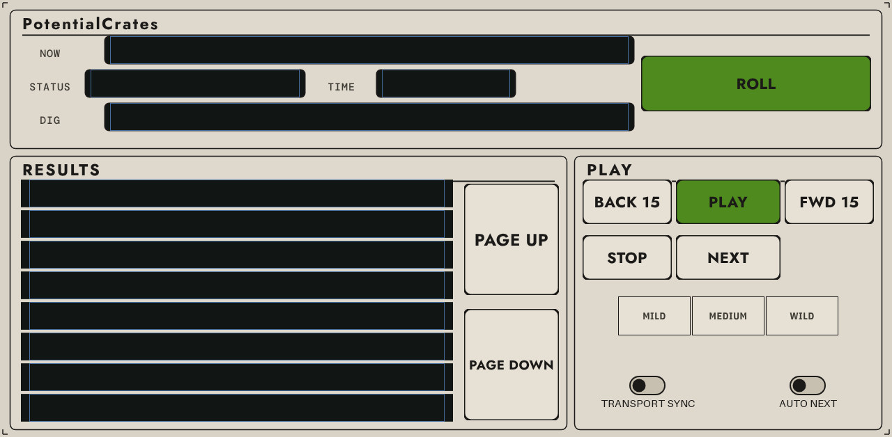

**Dig for records, one tap at a time.** PotentialCrates finds records on Discogs and streams one into your MPC track, ready to sample. It needs a network connection.

**Quick start**

1. Connect the MPC to your network. Load PotentialCrates as a plugin instrument.
2. Open the **CRATES** page and tap a crate. It searches and plays the first result.
3. Or open **DIG** and tap **SEARCH**, then tap a result.

**The eight crates**

| Crate | Digs in |
|---|---|
| **DRUM BREAKS** | Funk, Soul, Jazz-Funk, Boogaloo and Afrobeat, 60s and 70s |
| **LIBRARY** | Library records across Stage & Screen, Jazz and Electronic, 60s to 80s |
| **SOUNDTRACKS** | Soundtrack and Score, 60s to 80s |
| **JAZZ-FUNK** | Jazz-Funk, Soul-Jazz and Fusion |
| **PSYCH** | Psychedelic Rock, Krautrock, psychedelic Soul |
| **BOSSA & SAMBA** | Bossanova, Samba, MPB, Bossa Nova jazz |
| **DISCO & BOOGIE** | Disco and Boogie, 70s and 80s |
| **DUB & REGGAE** | Dub, Roots Reggae, Rocksteady |

**Controls**

| Control | What it does |
|---|---|
| **SEARCH** (DIG and FILTERS pages) | Digs Discogs with your filters. Leave them on ANY for anything at all |
| **FILTERS** page | Genre, style, decade, region and country, with arrows. **CLEAR FILTERS** sets them back to ANY |
| **ROLL** (FILTERS and CRATES pages) | Picks the filters for you, searches and plays the result. MILD stays near the genre you are in; WILD picks anything |
| **SOURCE: CHANNEL** | Digs random uploads from YouTube channels you list in `channels.txt` in the plugin's folder (see below) |
| **RESULTS** | 8 a page. Tap one to play it. **PAGE UP / PAGE DOWN** |
| **PLAY, STOP, BACK 15, FWD 15, NEXT** | The transport |
| **AUTO NEXT** | Moves to the next result when a track ends or won't play (on by default) |
| **TRANSPORT SYNC** | A track loads and waits, silent, until you press Play on the MPC, and the MPC's Stop pauses it. For resampling in time |

**Good to know**

- **`channels.txt`** is made the first time PotentialCrates starts: a copy of your old Crate Digger channel list if one is on the same drive, else a short how-to with examples. Write one channel a line (a channel link, an `@handle`, a `UC...` ID or a playlist link, then `|` and a name if you like). Updates never change a list with your own channels in it.
- If a dig finds nothing, it digs again with new picks, up to 3 times.
- The status line says why a track won't play: private video, removed, region blocked, rate limited or no network.
- The download is large (about 70 MB for a first-generation MPC, 90 MB for a second-generation one) because it carries its own streaming engine.
- Check that you have the right to use what you sample before you release it.
- PotentialCrates is a fork of Crate Digger by sd88me, built on Charles Vestal's schwung-webstream.

### 4.4 PotentialKits

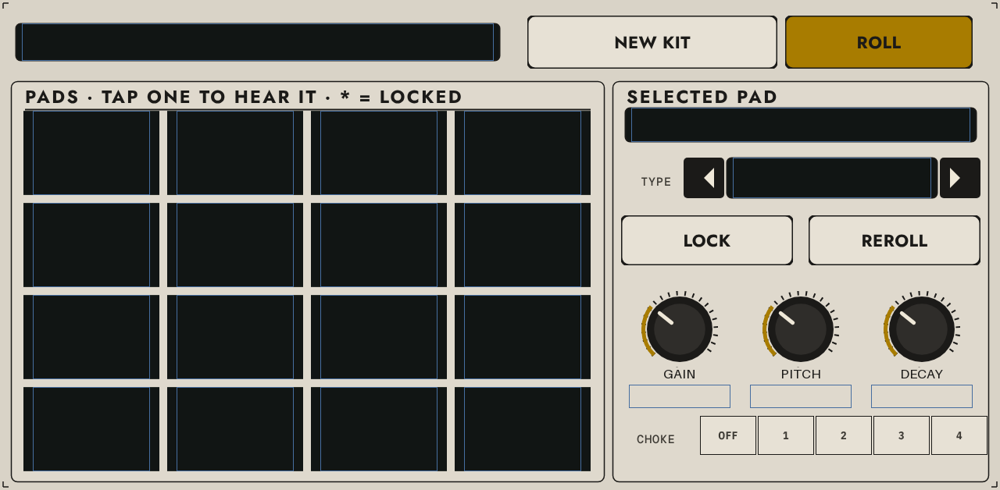

**A drum kit from your own samples.** PotentialKits reaches into your sample folders and pulls out 16 sounds for the pads: a kick, a snare, hats, percussion and a few surprises. Lock what you like, roll the rest, shape each pad, then save it as a real MPC drum program. It is a fork of sd88me's Lucky Dip.

**Quick start**

1. Load PotentialKits as a plugin instrument. The first time, it scans the **Expansions** and **Samples** folders on every drive (pick another folder on the SETUP page).
2. On the **KIT** page tap **NEW KIT** or **ROLL**, or tap a **KIT STYLE** on the STYLES page.
3. Play the pads, or tap a tile on the KIT page to hear it.
4. **LOCK** the pads you like and roll again. When the kit is right, open the **SAVE** page and tap **EXPORT KIT**.

**Pages**

| Page | What's on it |
|---|---|
| **KIT** | **NEW KIT**, **ROLL**, the 16 pad tiles, laid out like the MPC's pads (A01 bottom left; `*` = locked), and the selected pad: its sample, **TYPE**, **LOCK**, **REROLL**, **GAIN**, **PITCH** (±12 semitones), **DECAY** (100 % = the whole sample) and **CHOKE** (OFF or group 1-4) |
| **STYLES** | **KIT STYLES** (CLASSIC, BOOM BAP, LO-FI, TRAP, HOUSE, DUSTY JAZZ, PERCUSSION, ELECTRO, WEIRD), **ROLL KIT** with MILD / MEDIUM / WILD, **UNLOCK ALL**, **CLEAR ALL** |
| **SAVE** | **USER KITS** (tap **SAVE**, then a slot), **EXPORT KIT**, **MATCH LEVELS**, and a status line ("Saved to USER 3") |
| **SETUP** | Sample and export folders, **RESCAN**, copy or link samples, **SKIP LOOPS**, **NO DUPLICATES**, **FOLLOW PLAYED PAD**, **MAX SIZE**, and the LOOK |

**TYPE** is what the selected pad draws from: tap the arrows to step through AUTO (the pad's usual sound) and 23 types: KICK, SNARE, RIM, CLAP, HAT, CLOSED HAT, OPEN HAT, TOM, CONGA, PERCUSSION, CRASH, RIDE, CYMBAL, FX, GLITCH, VOX, BASS, SYNTH, STAB, CHORD, LEAD, PAD and OTHER. The pad gets a new sound of that type straight away.

**Kit styles** set what each pad draws from, its pitch, decay and choke, then pick a kit. Locked pads are left alone. **ROLL:** MILD gives up to four pads a new sample; MEDIUM makes a new kit with a little pitch and decay; WILD also mixes up what the pads draw from.

**Exported kits** are normal MPC drum programs (`.xpm`) with the 16 sounds on pads A01-A16, in `PotentialKits/Kits` at the top of the plugin's drive by default. Pads with PITCH, DECAY or GAIN changed are written as you hear them (new WAV files); CHOKE becomes the program's mute groups. With LINK TO ORIGINALS the samples stay where they are and PITCH is set on the pad instead. An MP3 pad is always written as a WAV, because the MPC loads WAVs beside a program.

**Q-Links:** GAIN, PITCH, DECAY and CHOKE of the selected pad (KIT page); the ROLL setting (STYLES page); NO DUPLICATES, SKIP LOOPS, MAX SIZE and copy or link (SETUP page).

**Good to know**

- Reads **WAV** (8, 16, 24 and 32-bit, float, mono or stereo, any sample rate), **AIFF** and **MP3**.
- Samples are sorted by their folder and file names (a folder called `Kicks` holds kicks).
- For a drums-only source, use **MAKE DRUM FOLDER** in MPC TOOLS (1.5.9 or later): it copies the drum and percussion one-shots from every drive into `DRUM ONE SHOTS` on the SD card, already in Kicks, Snares, Hats and so on folders. Then pick `DRUM ONE SHOTS` on the SETUP page and tap **RESCAN**.
- Favourites and rejects carried over from Lucky Dip live in `data/prefs.txt` in the plugin's folder (edit it to undo a reject); the buttons for them are no longer on the screen.
- Pads are one-shots, one voice each. Very long files are cut to 15 seconds.
- Your project remembers the kit, locks and settings, but not the samples themselves: a moved sample shows `!` on its tile.

### 4.5 Potential1200

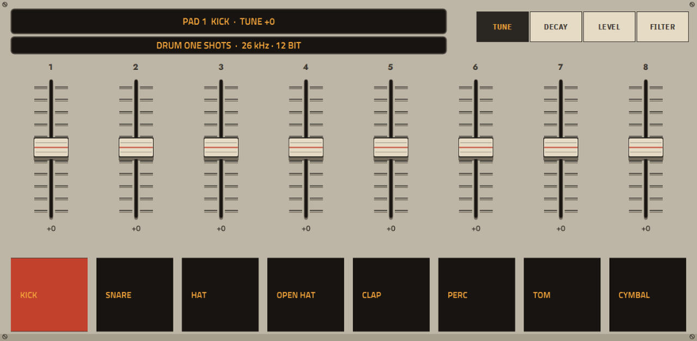

**That late-80s 12-bit drum sound.** Potential1200 puts your one-shots or a chopped break through the steps of the classic 12-bit sampler: every sound is taken at 26.04 kHz with no filter in front (the highs fold back as grit) and kept as 12 bits. Pitch works the old way: higher plays faster and shorter, lower plays slower, longer and dirtier. Eight faders and eight pads, like the original.

**Quick start**

1. Load Potential1200 as a plugin instrument.
2. On the **KIT** page tap **NEW KIT** (or **ROLL**), then play pads 1-8.
3. On **PERFORM** tap **TUNE**, **DECAY**, **LEVEL** or **FILTER**: the 8 faders jump to that setting of each pad.
4. For a break, tap **BREAK** on the KIT page, then **RANDOM BREAK**.
5. When it's right, tap **SAVE KIT** on SETUP.

**Pages**

| Page | What's on it |
|---|---|
| **PERFORM** | The 8 faders (TUNE ±12 semitones, DECAY, LEVEL or FILTER of each pad), the 8 pad tiles and a two-line display |
| **PROGRAM** | The selected pad: TUNE, DECAY, LEVEL, CUTOFF, FILTER (DYNAMIC, FIXED, OFF), **STRETCH**, **REVERSE**, CHOKE group, and START / END trim |
| **KIT** | **ONE-SHOTS**: each pad's type (KICK, SNARE, HAT, OPEN HAT, CLAP, PERC, TOM, CYMBAL), its sound with < > arrows, and L to lock it. **BREAK**: the break's waveform with numbered lines where each pad's chop starts and a moving playhead, RANDOM BREAK, PREV, NEXT, LIBRARY, CHOP (ON THE BEAT or ON THE HITS), TEMPO (AS IS, MATCH (TUNE), MATCH (STRETCH)), PLAY WHOLE BREAK and SHUFFLE PADS. **NEW KIT**, **ROLL** with MILD / MEDIUM / WILD, and **UNLOCK ALL** on both |
| **SETUP** | SAMPLE SPEED (33 or **45 > 33**), CHARACTER (**12 BIT 26 kHz** or CLEAN), PADS 9-16 (MULTI PITCH or OFF), **SAVE KIT**, **RESCAN**, and the LOOK |

**The filter, pad by pad.** Like the original, pads 1-2 start on a **DYNAMIC** 4-pole low-pass (the FILTER fader sweeps it), pads 3-6 on the **FIXED** low-pass, and pads 7-8 with the filter **OFF**. On a FIXED or OFF pad the FILTER fader shows FIXED or OFF and has nothing to move. Change any pad on the PROGRAM page.

**The 45 > 33 trick.** The old way to fit more into a short sampler: sample the record at 45 rpm, then tune it back down. Here the sound is taken faster and slowed back, so it keeps its pitch and length but has fewer samples: darker and crunchier.

**STRETCH** keeps a pad's length when you tune it, with a grainy, stuttery character rather than a clean modern stretch.

**Pads 9-16** play the selected pad at 0, 2, 3, 5, 7, 8, 10 and 12 semitones (**MULTI PITCH**). In BREAK mode, the pad after pad 16 plays the whole break.

**Where the sounds come from.** One-shots: a `DRUM ONE SHOTS` folder at the top of a drive (MPC TOOLS' **MAKE DRUM FOLDER** makes one), else the folders in `Potential1200/folders.txt`, else the drum sounds in your Expansions and Samples. Breaks: `DRUM BREAKS LIBRARY`, as for PotentialBreaks. Every break becomes **2 bars starting on a kick on the 1**, so it spreads evenly over the 8 pads: a loop file from its own first bar, a long take from a random strong kick. A 1-bar loop stays 1 bar.

**SAVE KIT** writes the 8 pads as an MPC drum program (`.xpm` plus WAVs, exactly as you hear them) to `Potential1200/Kits` on the sounds drive.

**Q-Links:** the 8 faders and the fader mode (PERFORM); TUNE, DECAY, LEVEL, CUTOFF, FILTER, STRETCH, REVERSE and CHOKE of the selected pad (PROGRAM); the ROLL setting, source, CHOP and TEMPO (KIT); SAMPLE SPEED, CHARACTER and PADS 9-16 (SETUP).

**Good to know**

- Reads **WAV**, **AIFF**, **FLAC** and **MP3**. Only the first 3 minutes of a file are read.
- The mix is mono and each pad plays one sound at a time, like the original. CHOKE groups cut each other.
- CHARACTER **CLEAN** turns the 12-bit, 26 kHz sound off, to hear the difference.
- Potential1200 is an independent project, not made by or connected with the makers of the original hardware.

### 4.6 PotentialNoise

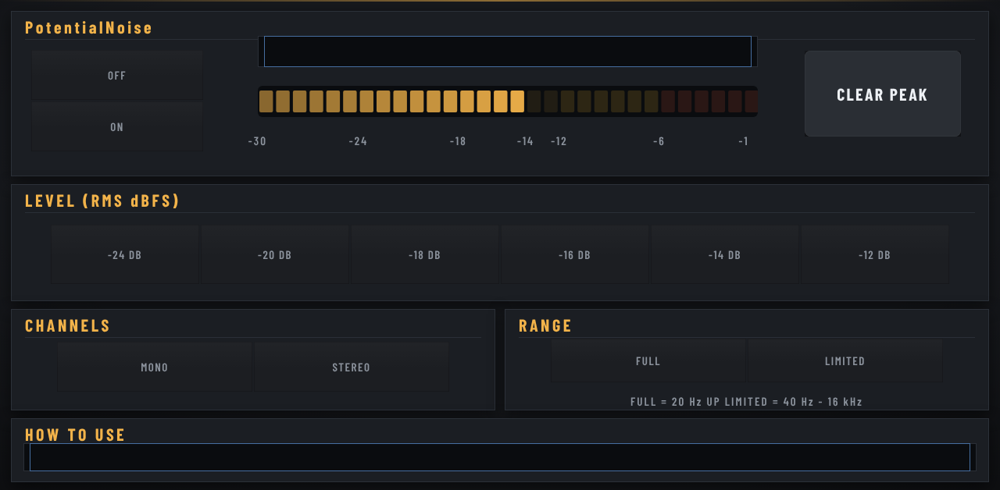

**Mix against the noise.** A calibrated pink noise reference for the pink-noise mixing method, with test tones, octave bands and a speaker check.

**The pink-noise method**

1. Add PotentialNoise to a track and pick a **LEVEL** (-14 dB is a good start).
2. Tap **ON**.
3. Solo each of your tracks with the noise playing, and raise its level until you can only just hear it over the noise.
4. Switch the noise off. You have a balanced starting point for your mix.

The **GUIDE** page walks you through this one tap at a time: **NEXT** switches the noise on and names each part of your beat in turn, with what to listen for. **DRUMS FIRST** or **SAMPLE FIRST** sets the order.

**Controls**

| Control | What it does |
|---|---|
| **NOISE ON / OFF** | Starts off. Fades over about 20 ms, so there are no clicks |
| **LEVEL** | -24, -20, -18, -16, -14 or -12 dB RMS, measured |
| **SIGNAL** | **PINK NOISE**, **TEST TONE** (1 kHz, 100 Hz, 60 Hz or 40 Hz), **OCTAVE BAND** (31 Hz to 16 kHz) or **SPEAKER CHECK** (left, right, in phase, out of phase) |
| **CHANNELS** | MONO or STEREO |
| **RANGE** | FULL (20 Hz and up) or LIMITED (40 Hz to 16 kHz) |
| **RMS / PEAK / CLEAR PEAK** | What it is sending. The meter shows the plugin's own output, not your mix |

**Q-Links:** ON, LEVEL, SIGNAL, TONE, BAND, CHANNELS, RANGE and CLEAR PEAK.

**Good to know**

- It is a starting point, not a finished mix.
- At -12 dB RMS the loudest noise peaks come close to 0 dBFS. -14 dB or lower leaves headroom.

## 5. The effects

### 5.1 PotentialPatina

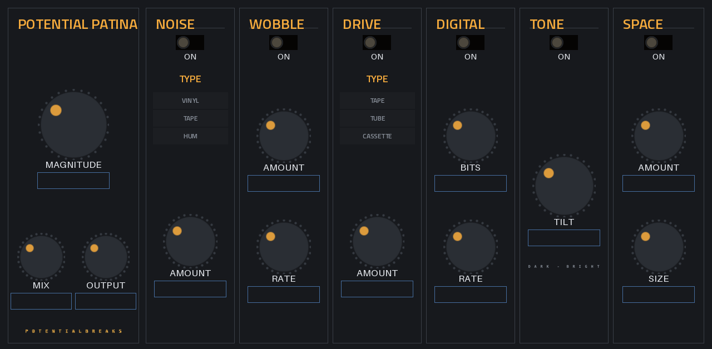

**Instant character.** Vinyl crackle, tape hiss and wobble, warm drive, bit-crushing, tone and a small room, all set with one big **MAGNITUDE** knob.

**Quick start:** add it as an insert, tap an **ERA**, then turn **AGE** to set how worn it sounds.

| Section | What it adds |
|---|---|
| **MAGNITUDE / MIX / OUTPUT** | Fade the whole effect in and out, blend it with the dry sound, set the level |
| **ERA** | One tap sets all six sections for a sound of its time: Patina, '50s 78, '60s 45, '70s Tape, '80s Sampler, '90s Cassette, AM Radio or VHS |
| **AGE** | Clean to fully worn in one move. 50 % is the sound as set. Tone comes in first, then drive, noise, wobble, and digital and space last |
| **NOISE** | Vinyl crackle, tape hiss or mains hum. **DUCK** turns the noise down while the music plays |
| **WOBBLE** | Tape wow and flutter |
| **DRIVE** | Tape, tube or cassette saturation, level-matched |
| **DIGITAL** | Bit depth and sample-rate reduction |
| **TONE** | One dark to bright tilt knob |
| **SPACE** | A small room |
| **ROLL** | Switches on a random set of sections with random settings |

Each section has its own **ON** switch.

**Presets (MPC's PRESET menu):** Patina, Dusty Vinyl, Worn Tape, Cassette Demo, 12-bit Sampler, Crunchy 8-bit, Old Radio, Basement Room and Clean; then the eight eras; then the four chain presets.

**Q-Links:** MAGNITUDE, AGE, MIX, OUTPUT, TONE, NOISE, WOBBLE and DRIVE, then the section settings on the next bank.

**Good to know:** about 7 ms of delay while it is on, because of how the wobble works. It can be heard on tight layered drums; put Patina on the bus instead. Stereo, 44.1 kHz.

### 5.2 PotentialPunch

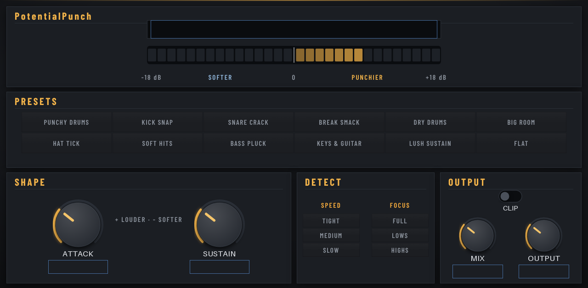

**Punch where you want it.** A transient shaper: make every hit snap harder or softer, and pull the tail up or tighten it, with no threshold to set. It reacts to how quickly each hit rises and falls, not to how loud the track is.

**Quick start:** add it as an insert, tap a preset, then fine-tune **ATTACK** and **SUSTAIN**. On a drum bus, start with Punchy Drums or Break Smack.

| Control | What it does |
|---|---|
| **ATTACK** | Up for more snap at the start of each hit (to about +18 dB), down to soften it |
| **SUSTAIN** | Up to bring the tail and room up, down to tighten and dry things out |
| **SPEED** | TIGHT, MEDIUM or SLOW: how long the attack part lasts and how long the tail is followed |
| **FOCUS** | What it listens to: FULL, LOWS (kicks, bass) or HIGHS (snares, hats). The whole sound is always shaped |
| **CLIP** | A soft clipper after the shaper, to catch the extra peaks |
| **AUTO LEVEL** | Evens the loudness in and out, so a punchier setting is not just louder |
| **MIX / OUTPUT** | Blend with the original sound, set the level |
| **ROLL** | A random setting that still sounds good |

**Presets (PRESETS buttons and the PRESET menu):** Punchy Drums, Kick Snap, Snare Crack, Break Smack, Dry Drums, Big Room, Hat Tick, Soft Hits, Bass Pluck, Keys & Guitar, Lush Sustain and Flat; the drum-bus pairs Boom Bap Bus, Lo-Fi Bus, Modern Bus and Glue Bus; the chain presets 90s Stab, Break Bus and Dub Drums.

**Q-Links:** ATTACK, SUSTAIN, MIX, OUTPUT, PRESET, SPEED, FOCUS and CLIP.

**Good to know:** turning ATTACK up raises the peaks, so leave CLIP on or lower OUTPUT if the track gets close to clipping. No added delay. Stereo, 44.1 kHz.

### 5.3 PotentialHeat

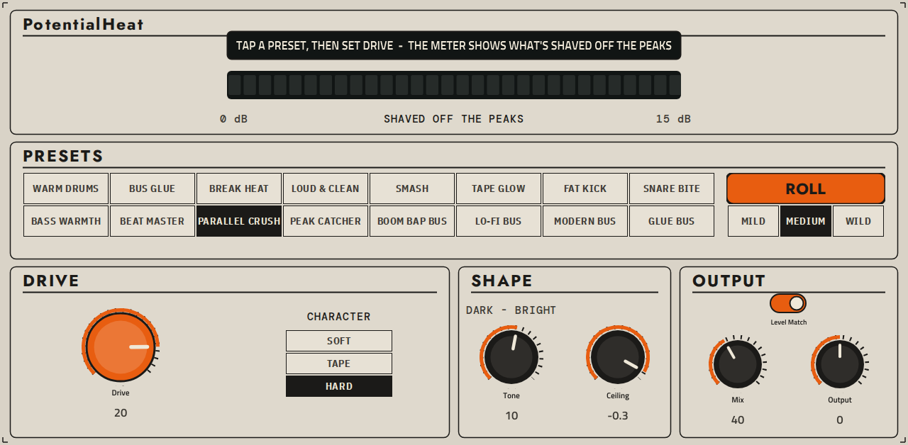

**Warmth, glue and loudness.** A soft clipper and bus saturator: push drums, breaks or the whole beat into a warm curve that rounds the peaks off instead of clipping.

**Quick start:** add it as an insert, tap a preset, then set how hard it works with **DRIVE**.

| Control | What it does |
|---|---|
| **DRIVE** | How hard the sound is pushed into the curve, 0 to 24 dB |
| **CHARACTER** | SOFT (clean until near the top), TAPE (darker and rounder) or HARD (firmest and loudest) |
| **TONE** | Dark to bright, after the saturation |
| **CEILING** | The most the peaks can reach, -6 to 0 dB |
| **LEVEL MATCH** | Turns the processed sound down by the loudness it gained, so you hear the colour. Off = a loudness clipper |
| **MIX / OUTPUT** | Blend with the original sound (parallel saturation), set the level |
| **ROLL** | A random setting that still sounds good |

**Presets:** Warm Drums, Bus Glue, Break Heat, Loud & Clean, Smash, Tape Glow, Fat Kick, Snare Bite, Bass Warmth, Beat Master, Parallel Crush and Peak Catcher; the drum-bus pairs Boom Bap Bus, Lo-Fi Bus, Modern Bus and Glue Bus.

**Q-Links:** DRIVE, TONE, MIX, OUTPUT, PRESET, CHARACTER, CEILING and LEVEL MATCH.

**Good to know:** the curves run at twice the sample rate inside, so it stays clean when pushed. It adds about 0.3 ms of delay (15 samples); the dry sound in MIX is delayed to match. Stereo, 44.1 kHz.

### 5.4 PotentialGrit

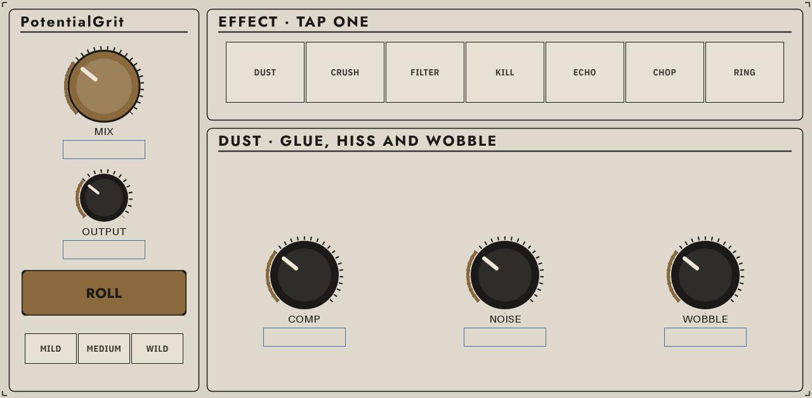

**Seven lo-fi effects in one box, one tap to switch.** Pick one from the pads, shape it with its own knobs, blend it with MIX. Each effect keeps its own settings, and switching crossfades so it won't click.

| Pad | What it does | Controls |
|---|---|---|
| **DUST** | Glue compression with soft saturation and a darker top, plus hiss, crackle and rumble that follow the music, and wobble | COMP, NOISE, WOBBLE |
| **CRUSH** | Bit depth and sample-rate reduction like an early sampler | BITS (2 to 16), RATE (1.5 to 44.1 kHz), TONE |
| **FILTER** | A resonant LOW, BAND or HIGH PASS filter into a saturator | CUTOFF, RESONANCE, DRIVE |
| **KILL** | A DJ-style three-band kill EQ: below 250 Hz, 250 Hz to 3 kHz, above 3 kHz | LOW, MID, HIGH |
| **ECHO** | A dark tape echo locked to your tempo: 1/16, 1/8T, 1/8, 1/8D, 1/4, 1/4D or 1/2. The dry sound always passes through | time pads, FEEDBACK, LEVEL |
| **CHOP** | A tempo gate that follows the song position, 1/4 to 1/32 with triplets | rate pads, DEPTH, PAN |
| **RING** | Ring modulation by a tone that an LFO can sweep two octaves each way | FREQ, SWEEP, SPEED |

**MIX** blends the original (0 %) with the effect (100 %). **OUTPUT** runs from -24 to +12 dB. **ROLL** gives the effect that is on new settings; WILD sometimes picks another effect too.

**Presets (PRESET menu):** Dusty drum bus, Worn record, 12-bit grit, Broken, Next room, Telephone, Dub throw, Stutter, Ping-pong chop and Metal; then the four chain presets.

**Q-Links:** the effect, MIX and OUTPUT, then the knobs of the effects.

### 5.5 PotentialBleed

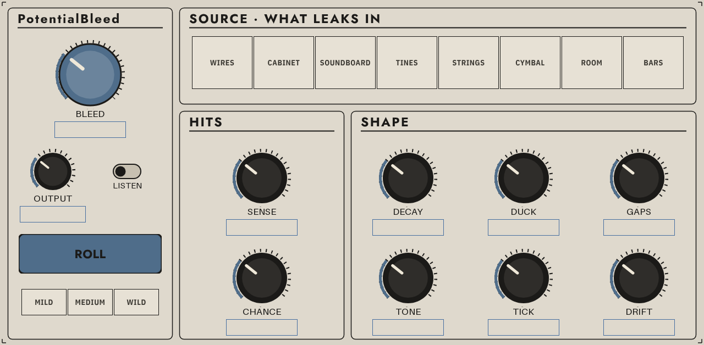

**The sounds between the chops.** PotentialBleed listens for each hit and adds quiet, synthetic residue behind it, so your chops sound like they came off a real recording with other instruments leaking in. Nothing is delayed.

**Quick start:** put it on a chopped loop or a drum bus and turn **LISTEN** on. Lower **SENSE** until the important hits ring, then raise **BLEED** until you hear it clearly. Turn LISTEN off and bring BLEED back down until the residue sits behind the track.

| Source | Sounds like |
|---|---|
| **WIRES** | Snare wires rattling behind the kick |
| **CABINET** | A bass cabinet's low thump and boom |
| **SOUNDBOARD** | A piano's wooden board ringing |
| **TINES** | Bright struck tines, electric-piano style |
| **STRINGS** | String scrape and ring |
| **CYMBAL** | A soft metallic wash |
| **ROOM** | A small room's low ring and air |
| **BARS** | Vibraphone-like bars |

All eight are generated in the plugin, not recordings.

| Control | What it does |
|---|---|
| **BLEED** | How much leaks in. Small amounts usually sound most real |
| **SENSE** | How hard a hit has to be, -60 to -6 dB |
| **CHANCE** | How often a hit leaks: 100 % is every hit |
| **DECAY** | How long the residue rings, 30 ms to 1.5 s |
| **DUCK / GAPS** | Keeps it down under loud audio; brings it up in the quiet spaces |
| **TONE** | Dark to bright |
| **TICK** | Adds a needle tick on each hit |
| **DRIFT** | A slow wobble, slightly different left and right |
| **LISTEN** | Hear just the residue, to set it up |
| **ROLL** | Picks a new source and shape |

**Presets (PRESET menu):** Wires behind the kit, Bass in the room, Piano lid open, Rhodes shimmer, Guitar scrape, Cymbal wash, Small room, Vibes and Old record; then the four chain presets.

**Q-Links:** BLEED, SOURCE, DECAY, SENSE, CHANCE, DUCK, GAPS and TONE, then TICK, DRIFT, OUTPUT and LISTEN.

### 5.6 PotentialWarp

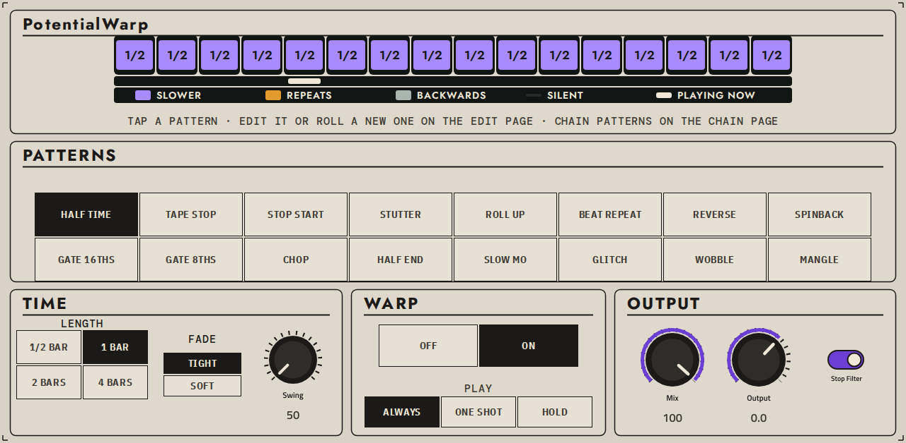

**Bend time on the beat.** Warp keeps the last few seconds of whatever you feed it and plays them back through a 16-step pattern locked to your sequence.

**Quick start:** add it as an insert, press **Play** on the MPC, then tap a pattern. Try Half Time or Tape Stop on a drum bus, Stutter or Roll Up on a break, Reverse on a vocal chop.

| Move | What you hear |
|---|---|
| **Straight** | The sound as it is |
| **1/2, 1/4 speed** | Drops an octave (or two) and drags behind the beat |
| **Tape stop / start** | Slows to a stop, or spins up from silence |
| **Repeat** | Stutters a slice, from an 8th down to a 64th roll, with triplets |
| **Backwards / Spinback** | The last moment in reverse, or a fast spinback |
| **Silent** | Gates the sound out |

| Control | What it does |
|---|---|
| **PATTERNS** | 16 one-tap pads: Half Time, Tape Stop, Stop Start, Stutter, Roll Up, Beat Repeat, Reverse, Spinback, Gate 16ths, Gate 8ths, Chop, Half End, Slow Mo, Glitch, Wobble and Mangle |
| **LENGTH** | How long the 16 steps last: 1/2 BAR, 1 BAR, 2 BARS or 4 BARS |
| **SWING** | 50 % (straight) to 75 %, MPC style |
| **FADE** | TIGHT or SOFT |
| **WARP** | ON or OFF. Automate it to drop the effect in and out |
| **PLAY** | **ALWAYS** runs with the song. **ONE SHOT** plays a pattern once. **HOLD** plays only while you hold a pad (pads A01 to A16 play patterns 1 to 16) |
| **STOP FILTER** | A low-pass that closes as a Tape Stop runs down |
| **MIX / OUTPUT** | Blend with the original sound, set the level |

**EDIT page:** tap a step, then tap what it does. Steps next to each other with the same move join into one longer move. **ROLL** rolls a new pattern for the pad; **RESET PAD** puts the pad's own pattern back. Every pad's pattern is saved with your project.

**CHAIN page:** tap a slot (1 to 8), then the pattern for it, and turn **CHAIN** on. The slots play in turn, one LENGTH each. (This chains Warp's own patterns. It is not the FX chains of chapter 6.)

**Q-Links:** PATTERN, LENGTH, MIX, OUTPUT, WARP, FADE, SWING and PLAY.

**Good to know:** it follows the song position, in 4/4. When the sequence is stopped it keeps its own time at the project tempo. HOLD needs pads or keys, because the touchscreen does not tell a plugin when your finger lifts.

## 6. Working together: FX chains

### The four chains

Four ready-made chains use Patina, Punch, Grit and Bleed together. Each chain is a preset **with the same name in every plugin of the chain**. Each plugin's preset holds its own part of the sound.

| Chain | For | Inserts, in order |
|---|---|---|
| **Dusty Loop** | Soul, jazz and library loops | **Bleed → Patina → Grit** |
| **90s Stab** | Chopped horns, keys and vocal stabs | **Grit → Punch → Bleed → Patina** |
| **Break Bus** | A boom-bap drum bus | **Punch → Grit → Bleed → Patina** |
| **Dub Drums** | Lo-fi dub drums | **Patina → Punch → Bleed → Grit** |

Dusty Loop does not use Punch, so Punch has no preset by that name.

### Loading a chain, step by step

Using **Break Bus** as the example:

1. Open the inserts of your drum track or drum bus.
2. Add the plugins **in the order shown**: insert 1 PotentialPunch, insert 2 PotentialGrit, insert 3 PotentialBleed, insert 4 PotentialPatina.
3. Open Punch and tap **Break Bus** on its PRESETS buttons.
4. Open Grit, tap the **PRESET** menu at the top of the plugin screen and pick **Break Bus**. Do the same in Bleed and Patina.
5. Match the level with the last plugin's **OUTPUT**, then tweak.

The plugins do not talk to each other. Picking a chain preset in one plugin does not change the others, so pick it in each.

| Plugin | Where to pick the chain preset |
|---|---|
| Patina, Grit, Bleed | The MPC's **PRESET** menu at the top of the plugin screen |
| Punch | Its own **PRESETS** buttons (also in the PRESET menu) |

### What each plugin does in each chain

| Chain | Insert 1 | Insert 2 | Insert 3 | Insert 4 |
|---|---|---|---|---|
| **Dusty Loop** | **Bleed**: SOUNDBOARD, dark, long decay | **Patina**: '60s 45, vinyl noise, tube drive, a little room | **Grit**: FILTER, low pass, gentle | |
| **90s Stab** | **Grit**: CRUSH at 12 bits | **Punch**: attack +30, TIGHT, mix 80 % | **Bleed**: TINES, 60 % chance | **Patina**: '90s Cassette at 60 % mix |
| **Break Bus** | **Punch**: attack +50, sustain +15, CLIP on | **Grit**: DUST, mostly glue | **Bleed**: WIRES, short | **Patina**: '70s Tape at 50 % mix |
| **Dub Drums** | **Patina**: '80s Sampler, 12-bit, no noise | **Punch**: attack +60, sustain -25, LOWS | **Bleed**: ROOM, up in the gaps | **Grit**: ECHO at 1/8 dotted |

The exact values are in the developer reference (chapter 14).

### Why the order matters

- **Punch early.** Shape the hits before compression, crushing or tape, so the shaper sees clean transients.
- **Bleed before Patina.** The bleed is then aged with the sound instead of pasted on top.
- **Echo and chop last.** Grit's ECHO and CHOP, and Warp, should work on the finished sound.
- **One noise source per chain.** Patina's NOISE and Grit's DUST both add noise; two at once turns to mush.
- **Match levels with OUTPUT** before you decide whether you like it.

### Drum-bus pairs: Punch and Heat

**Boom Bap Bus, Lo-Fi Bus, Modern Bus** and **Glue Bus** are in both PotentialPunch and PotentialHeat, made to work together. On your drum bus:

**Punch → Heat**

Pick the same name on the PRESETS buttons of each. Punch shapes the hits, Heat warms them up and catches the peaks.

### Where Heat, Warp and Noise fit

- **Heat** works well as the last insert after any of the four chains, to glue the result and catch peaks. Start with Bus Glue or Peak Catcher. On the master, try Beat Master or Loud & Clean with LEVEL MATCH off.
- **Warp** goes last, so it bends the finished sound: for example **Punch → Grit → Bleed → Patina → Warp**.
- **Noise** is for the mix, once the beat is built: balance the dry tracks, add your chains, then match each chain's level with its OUTPUT.

### Chains of your own

Dial in a sound across several plugins, then save each plugin's part to **the same USER slot number**, for example USER 3 in Punch, Grit and Bleed. To bring the chain back in any project, add the plugins in the same order and tap USER 3 in each. Chapter 7 covers the USER page.

### A worked example

1. **Dig:** in PotentialBreaks, tap ROLL until a break fits.
2. **Shape:** on that track's inserts add Punch, Grit, Bleed and Patina, and pick **Break Bus** in each.
3. **Melody:** in PotentialWax, tap RANDOM TRACK, set KEY, and play the pads. Add Bleed, Patina and Grit to its track and pick **Dusty Loop** in each.
4. **Glue:** send both to a bus with Heat on **Bus Glue**.
5. **Move:** add Warp last on the drum track, PLAY on ONE SHOT, and tap Tape Stop at the end of a phrase.
6. **Balance:** load PotentialNoise on a spare track and follow its GUIDE page.

## 7. USER presets

Patina, Punch, Heat, Grit and Bleed each have a **USER** page with eight slots of your own. The MPC has no "save preset" for plugins like these, so the plugins keep their own.

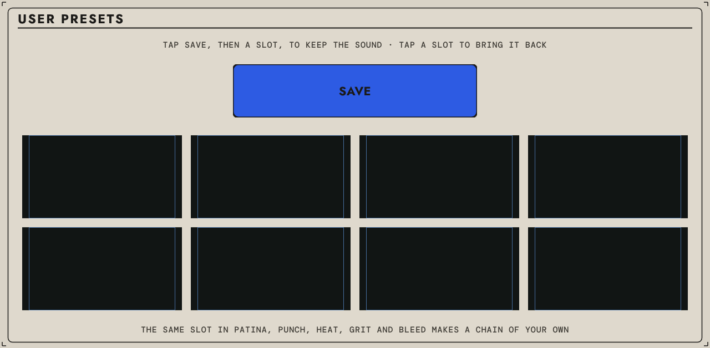

| To | Do this |
|---|---|
| **Save** | Tap **SAVE** (it lights and reads NOW TAP A SLOT, and stays lit until you tap a slot), then tap a slot, empty or full |
| **Load** | Tap a slot |
| **Cancel a save** | Tap SAVE again |

- A filled slot reads **USER 1** to **USER 8**. An empty one reads **EMPTY**. The slot you loaded or saved last is lit.
- Saving to a filled slot replaces it straight away. There is no confirm step and no undo.
- No typing: slots are known by their number.

**What a slot keeps:** the knobs and switches that make the sound. In Grit, the effect that is on and the settings of all seven. It does not keep the ROLL setting, the look, the built-in preset's highlight (Punch and Heat) or Bleed's LISTEN switch.

**PotentialKits** has the same thing for whole kits: **USER KITS** on its SAVE page keep the samples, locks, sounds, pitch, decay and choke of all 16 pads, in `PotentialSuite Presets/PotentialKits/`.

**Where the slots live:** on the drive the plugin is on, in a folder called `PotentialSuite Presets` beside `VST2 Plugins`, one small text file per plugin. So:

- every project sees the same slots, and so does every copy of the plugin on other tracks;
- updating the plugin keeps them;
- you can back the folder up, or copy it to another MPC's drive.

If the plugin is moved to a different drive, copy the `PotentialSuite Presets` folder to that drive too.

## 8. Troubleshooting

**The plugin is not in my plugin list.**
Restart the MPC: the list only updates when the MPC app starts. Check the right list: Patina, Punch, Heat, Grit, Bleed and Warp are insert effects, not instruments. On MPC OS 3.10.1, check that **External Plugin Support** is on and the folder is inside `VST2 Plugins` at the top of the drive. After a firmware update you may need to switch plugin support on again.

**It shows up twice.**
It was installed two ways. Remove one copy.

**The look did not change.**
A new look shows the next time the plugin loads. Take the plugin off the track and add it again, or load the project again.

**My look went back to Print Plate after an update.**
MPC TOOLS before 1.5.6 replaced the whole plugin folder. Update MPC TOOLS, then pick the look again.

**Potential1200 says NO SOUNDS FOUND.**
Make a drum folder with MPC TOOLS (**MAKE DRUM FOLDER**), or list your folders in `Potential1200/folders.txt`, then tap **RESCAN** on SETUP.

**PotentialKits says No samples found.**
It scans the Expansions and Samples folders at the top of each drive. Pick your sample folder on its SETUP page and tap **RESCAN**. Samples must be WAV, AIFF or MP3.

**PotentialBreaks says NO BREAKS FOUND, or PotentialWax finds no songs.**
Check the folder name and place (chapters 4.1 and 4.2), then tap **RESCAN**. Breaks and Wax both read WAV, FLAC and MP3.

**Pad 1 does not play the first slice or cue.**
The MPC treats a plugin track like a keyboard, so the pads can send different notes. Tap **LEARN**, then hit the pad you want as pad 1.

**The tempo is double or half.**
Put the BPM in the file name (`Funky Drummer 101bpm.wav`). In Wax, use ÷2 or ×2.

**PotentialCrates says to add channels to channels.txt.**
Open `channels.txt` in the plugin's folder (on a computer, or copy it over with MPC TOOLS' File Browser) and add your channels, one a line. PotentialCrates 1.1.2 and later make the file for you, from an old Crate Digger list if it finds one.

**PotentialCrates plays nothing.**
Check the network first, then read the status line: it says why (private, removed, region blocked, rate limited).

**My drums sound slightly late with Patina.**
Patina adds about 7 ms of delay. Put it on the bus so everything moves together.

**A USER slot did not save.**
Update the plugin first: before the versions of 14 November 2026 (Patina 1.5.1, Punch 1.5.1, Heat 1.4.1, Grit 1.1.2, Bleed 1.1.1, Kits 1.1.0) one tap on SAVE could switch it straight back off. Then wait three seconds after the plugin or project loads before tapping slots: taps are ignored for a moment so that loading a project cannot change a slot. Check that the drive is not full or read-only.

**The chain does not sound like I expected.**
Check the insert order, check the same preset name is picked in every plugin of the chain, and match the level with OUTPUT.

**Something else.**
Each plugin's GitHub page has an issue form. Short reports are fine: "the PITCH knob does nothing on my Live II" is a perfect bug report.

## 9. Compatibility and CPU

### Tested on

| Plugin | Tested on |
|---|---|
| **PotentialBreaks** | MPC One (HAKAI 3.10, MPC OS 3.10.1) |
| **PotentialWax** | MPC Key 37 (MPC OS 3.10.1); MPC Live (MPC OS 3.10.1); MPC One (HAKAI 3.10, MPC OS 3.10.1) |
| **PotentialCrates** | MPC One (MPC OS 3.10.1) |
| **PotentialKits** | MPC One (MPC OS 3.10.1) |
| **Potential1200** | MPC One (MPC OS 3.10.1) |
| **PotentialNoise** | MPC One (HAKAI 3.10, MPC OS 3.10.1) |
| **PotentialPatina** | MPC Key 37 (MPC OS 3.10.1); MPC One (HAKAI 3.10, MPC OS 3.10.1) |
| **PotentialPunch** | MPC Key 37 (MPC OS 3.10.1); MPC One (HAKAI 3.10, MPC OS 3.10.1) |
| **PotentialHeat** | MPC One (HAKAI 3.10, MPC OS 3.10.1) |
| **PotentialGrit** | MPC One (MPC OS 3.10.1) |
| **PotentialBleed** | MPC One (MPC OS 3.10.1) |
| **PotentialWarp** | MPC One (MPC OS 3.10.1) |

"Tested" means someone ran that plugin on that MPC and reported it. Every plugin is built for first-generation (32-bit) and second-generation (64-bit) MPCs; the 64-bit builds pass Akai's own checks. If you try a plugin on another model, please report how it went on its GitHub page.

### CPU

Measured on an MPC One (MPC OS 3.10.1) with the Open MPC bench, from MPC TOOLS' **TEST** button, as a share of one audio block. Under 15 % at the 99th percentile and 50 % in the worst block is a PASS: several copies run alongside a normal project.

| Plugin and version | 99th percentile | Worst block |
|---|---|---|
| **PotentialBreaks** 1.7.0 | 1.5 % | 2.5 % |
| **PotentialWax** 1.8.0 | 5.7 % | 6.9 % |
| **PotentialCrates** 1.1.2 | 1.0 % | 3.9 % |
| **PotentialKits** 1.1.1 | 3.2 % | 6.9 % |
| **Potential1200** 1.0.1 | 7.3 % | 11.0 % |
| **PotentialNoise** 2.4.0 | 1.6 % | 2.5 % |
| **PotentialPatina** 1.5.1 | 6.4 % | 7.7 % |
| **PotentialPunch** 1.5.1 | 3.3 % | 4.7 % |
| **PotentialHeat** 1.4.1 | 5.9 % | 6.6 % |
| **PotentialGrit** 1.1.2 | 3.2 % | 4.6 % |
| **PotentialBleed** 1.1.1 | 3.3 % | 4.6 % |
| **PotentialWarp** 1.3.0 | 4.6 % | 7.0 % |

# Part 2: Developer reference

## 10. How a plugin is put together

Each plugin is a native **VST2** shared library for ARM Linux, loaded by MPC's own plugin host, with a native MPC screen skin. All twelve are built with the open [Open MPC kit](https://github.com/open-mpc/mpc-vst-plugins) (`mpc-vst-plugins`, MIT).

| Layer | Where | What it does |
|---|---|---|
| **Engine** | `src/<name>.c` in the plugin's repo | The DSP and all behaviour. Plain C, no dependencies beyond libm. Exposes `mpc_engine()` |
| **Wrapper** | The kit's `wrapper/vst2_wrap.c` | Turns the engine into a VST2 plugin: parameters, state chunk, MIDI, audio blocks |
| **Parameters** | `vst/params.json`, `vst/params.lock` | The parameter list, in VST index order. The kit generates `params.h` from it |
| **Layout** | `vst/layout.base.conf` | Where every control sits on each tab |
| **Looks** | `shared/looks/`, `vst/skin/looks/` | Turns the one layout into four skins and merges them |
| **Shared headers** | `shared/` | The same files in every repo: look switch, USER slots, MANUAL page |

### Repositories

| Repository | Holds |
|---|---|
| `PotentialBreakfast/mpc-vst-potential<name>` | One plugin each: 1200, bleed, breaks, crates, grit, heat, kits, noise, patina, punch, warp, wax |
| `PotentialBreakfast/potential-plugins` | The overview page, this manual, the suite FAQ and install guide |
| `PotentialBreakfast/mpc-tools` | MPC TOOLS, the Windows and Mac companion app (Go) |
| `open-mpc/mpc-vst-plugins` | The build kit, and the Open MPC catalogue registry |

### Layout of a plugin repo

```
src/<name>.c              the engine
vst/vst.json              name, vendor, uid, version, defines, sources
vst/params.json           parameters, in index order
vst/params.lock           the keys in order: append-only
vst/presets.json          presets for the MPC's PRESET menu (some plugins)
vst/layout.base.conf      the layout, edited by hand
vst/layout*.conf          generated: one per look
vst/manual.txt            the on-screen manual
vst/skin/looks/           stylesheets, fonts and plugin.json (accent colours, hero knobs)
shared/looks/             make_looks.py, build_looks.py, potential_theme.h
shared/potential_user.h   USER slots (the five effects)
shared/potential_manual.h MANUAL page
shared/akai/akai_pack.py  Akai's plugin-folder format
tests/                    engine tests (some plugins)
.github/workflows/        release.yml
.github/release-notes/    v<version>.md: adding one triggers a release
tested.json               devices the plugin has been reported working on
```

## 11. The engine interface

The engine implements the kit's `wrapper/engine.h`. Audio is **44100 Hz, interleaved int16 stereo, in blocks of up to 128 frames**.

```c
typedef struct {
    void *(*create)(const char *data_dir);
    void (*destroy)(void *inst);
    void (*midi)(void *inst, const uint8_t *msg, int len);
    void (*set_param)(void *inst, const char *key, const char *val);
    int  (*get_param)(void *inst, const char *key, char *buf, int buf_len);
    void (*render)(void *inst, int16_t *out_lr, int frames);            /* instruments */
    void (*process)(void *inst, const int16_t *in_lr, int16_t *out_lr, int frames);  /* effects */
    void (*song_pos)(void *inst, double ppq, double bpm, int playing, int frames);
} mpc_engine_t;
const mpc_engine_t *mpc_engine(void);
int mpc_engine_changed(void *inst, char *key, int len);   /* optional, weak */
```

| Function | Notes |
|---|---|
| `create(data_dir)` | `data_dir` is the plugin's own folder (`"MODULE_SUBDIR": "\".\""` in `vst.json`). The looks, USER slots and file-based plugins find their files from it |
| `set_param(key, val)` | Values arrive as text. Options arrive as their index. A trigger arrives as 1 |
| `get_param(key, buf)` | Returns the number of characters written, 0 for an unknown key |
| `process` / `render` | The wrapper never calls two functions at once for one instance, but calls may come from the screen and audio threads |
| `song_pos` | With `"HAS_SONG_POS": 1`: song position in beats, tempo and transport once per block. Grit, Warp and Crates use it |
| `mpc_engine_changed` | The engine names parameters it changed itself (a ROLL, a USER slot load), one key per call, so MPC's screen follows |

### Keys the wrapper asks for

| Key | Meaning |
|---|---|
| `state` | The whole state as text, `key=value;key=value;...`. Saved in the project and restored with `set_param("state", ...)`. Restoring sets values directly, without re-applying a preset |
| `display_rev` | With `HAS_DISPLAY_REV`: a counter the engine bumps when on-screen text changed. The four plugins with a preset strip set `DISPLAY_REV_NO_UPDATE`, because a screen refresh closes MPC's PRESET menu |
| `<key>_display` | With `"dynamic_display": true` on a parameter: its value text (Grit's rates and times) |
| `<key>_N`, `<key>_N_on` | A `list` widget's rows: the text of row N and whether it is lit |
| `<key>:<n>` | With `"programs"` in `vst.json`: the name of preset n |

### Conventions across the suite

- **Parameter 0** is never a live control: MPC flicks parameter 0 when the transport stops.
- **Triggers** (`"type": "trigger", "momentary": true`) fire on a press. The wrapper debounces them.
- **`dice`** is the ROLL trigger and **`wild`** its MILD / MEDIUM / WILD option.
- **`theme`** is the LOOK selector. It is not in `state`.
- **`manual_page`**, **`user_save`** and **`user_1` to `user_8`** are not in `state`.
- A project reload replays parameter values, so anything that acts on a tap ignores taps for 3 seconds after `create` and after a `state` restore.
- Presets changed "only on a change": re-sending the same preset number keeps the user's tweaks.

## 12. Parameters

`vst/params.json` lists the parameters in VST index order. **The list is append-only**: `vst/params.lock` holds the keys in order and the build fails if an existing key moves, because saved projects and MPC automation address parameters by index.

| Field | Meaning |
|---|---|
| `key` | The name used by the engine, the layout and `state` |
| `name` | The name MPC shows |
| `min`, `max`, `default`, `unit` | A continuous parameter |
| `options` | A list of choices; the value is the index |
| `type` | `trigger`, `readout`, `slot` and others; absent for an ordinary control |
| `momentary` | A trigger that springs back |
| `display: "string"` | The parameter's text comes from the engine |
| `live`, `poll` | Whether the text is re-read while the page is open |
| `dynamic_display` | The value text comes from `<key>_display` |
| `legacy` | Kept only so old projects load |

Appendix A lists every parameter of every plugin.

## 13. Layout and looks

`vst/layout.base.conf` is the only layout edited by hand. The screen is 1280 × 800; the plugin area starts at y = 100.

```
[tab PUNCH]
frame x=14 y=100 w=1252 h=604 title="PotentialPunch"
knob cx=220 cy=330 r=59 label="ATTACK" key=attack
enum_v cx=721 cy=600 label="SPEED" key=speed sw=124
toggle cx=1040 cy=514 label="CLIP" key=clip
button cx=640 cy=250 label="SAVE" label_on="NOW TAP A SLOT" key=user_save w=440 h=96
list x=40 y=330 w=1200 h=316 cols=4 rows=2 th=150 gap=16 key=user mark=1
qlinks "PUNCH" = attack,sustain,mix,output,preset_pick,speed,focus,clip
```

| Widget | Use |
|---|---|
| `frame`, `text` | A titled panel; free-standing text |
| `knob`, `slider_v`, `slider_h` | Continuous controls. A knob's radius must be 59 or less (MPC garbles taller filmstrips) |
| `toggle`, `button` | A switch; a trigger or latching button with `label_on=` |
| `enum_h`, `enum_v` | One button per option |
| `readout`, `list` | Engine text; rows of engine text that can be tapped |
| `picture`, `meter`, `art` | Images that follow a parameter, or sit in the background |
| `qlinks "TAB" = a,b,c` | The Q-Link assignments of a tab, in banks |
| `when=<param>:<option>` | On any line: show the widget only in that mode (Grit's effect panels, the MANUAL pages) |

A button key used on several pages shares one image, so it must be the same size everywhere.

### The looks

`shared/looks/make_looks.py vst` writes `layout.conf` (Print Plate), `layout.rack.conf` (Night Rack), `layout.block.conf` (Colour Block) and `layout.vintage.conf` (Vintage) from the base layout, adding each look's palette and the plugin's own colour from `vst/skin/looks/plugin.json`:

```json
{"name": "PotentialPunch",
 "accent": {"print": "2d5be3", "rack": "7c9bff", "block": "6f93ff", "vintage": "2d5be3"},
 "hero": ["attack", "sustain"]}
```

It also appends the **MANUAL** tab (from `vst/manual.txt`) and the **SETTINGS** tab with the LOOK selector. `shared/looks/build_looks.py vst <kit>` builds all four with the kit's `gen_vst.py` and merges them with `make_skinset.py`.

**Switching looks.** MPC reads a skin only when a plugin loads. `shared/looks/potential_theme.h` copies the chosen look's `TUI.json` and Q-Link maps into `Plugin Skins/` and writes the look's name to `Plugin Skins/ui.txt`; the new look shows on the next load.

### The MANUAL page

`vst/manual.txt` is the on-screen manual:

```
= START                 a page; START is its button
# Heading
Body text, wrapped for you.
- A bullet
```

`make_looks.py` wraps the text, stops the build if a page does not fit (13 lines under the heading), and draws each page with `when=manual_page:<n>`. The page names must match the options of the parameter `manual_page`, in order. `shared/potential_manual.h` holds the page number:

```c
pm_manual_t manual;                                       /* in the instance */
if (pm_set(&s->manual, key, val)) return;                 /* in set_param() */
n = pm_get(&s->manual, key, buf, buf_len); if (n) return n;   /* in get_param() */
```

## 14. Presets and USER slots

### Built-in presets

- **Punch, Heat, Warp** keep presets in the engine (a table in the C source) and expose them through `"programs": {"param": "preset_pick"}` in `vst.json`, so the same list is on the page and in MPC's PRESET menu.
- **Patina, Grit, Bleed** use `vst/presets.json`, which the kit turns into MPC preset files:

```json
{"presets": [
  {"name": "Break Bus",
   "values": {"fx": "DUST", "dust_comp": 75, "dust_noise": 15, "dust_wobble": 10, "mix": 100, "output": 0}}
]}
```

Values are applied in file order. Patina's presets set `era` first, because picking an era sets the six sections, and the values after it then overwrite them.

**Chain presets** are ordinary presets that share a name across plugins. To add a chain, add a preset of the same name to each plugin in it and document the insert order.

### Chain preset values

**PotentialPatina** (`vst/presets.json`)

| Parameter | Dusty Loop | 90s Stab | Break Bus | Dub Drums |
|---|---|---|---|---|
| `era` | '60s 45 | '90s CASSETTE | '70s TAPE | '80s SAMPLER |
| `magnitude` | 100 | 100 | 100 | 100 |
| `mix` | 85 | 60 | 50 | 85 |
| `output` | 0 | 0 | 0 | 0 |
| `noise_on` | On | On | On | Off |
| `noise_type` | Vinyl | Tape | Tape | Vinyl |
| `noise_amt` | 30 | 24 | 18 | 19 |
| `wobble_on` | On | On | On | Off |
| `wobble_amt` | 16 | 28 | 26 | 18 |
| `wobble_rate` | 22 | 58 | 35 | 30 |
| `drive_on` | On | On | On | On |
| `drive_type` | Tube | Cassette | Tape | Tube |
| `drive_amt` | 26 | 34 | 36 | 14 |
| `digital_on` | Off | Off | Off | On |
| `digital_bits` | 12 | 12 | 12 | 12 |
| `digital_rate` | 26 | 26 | 26 | 26 |
| `tone_on` | On | On | On | On |
| `tone_tilt` | -28 | -20 | -14 | -8 |
| `space_on` | On | Off | Off | Off |
| `space_amt` | 12 | 18 | 18 | 18 |
| `space_size` | 35 | 50 | 50 | 50 |
| `age` | 45 | 35 | 30 | 50 |

**PotentialGrit** (`vst/presets.json`)

| Parameter | Dusty Loop | 90s Stab | Break Bus | Dub Drums |
|---|---|---|---|---|
| `fx` | FILTER | CRUSH | DUST | ECHO |
| `filt_mode` | LOW PASS |  |  |  |
| `filt_cutoff` | 75 |  |  |  |
| `filt_res` | 10 |  |  |  |
| `filt_drive` | 20 |  |  |  |
| `mix` | 100 | 100 | 100 | 100 |
| `output` | 0 | 0 | 0 | 0 |
| `crush_bits` |  | 12 |  |  |
| `crush_rate` |  | 84 |  |  |
| `crush_tone` |  | 55 |  |  |
| `dust_comp` |  |  | 75 |  |
| `dust_noise` |  |  | 15 |  |
| `dust_wobble` |  |  | 10 |  |
| `echo_time` |  |  |  | 1/8D |
| `echo_fb` |  |  |  | 45 |
| `echo_level` |  |  |  | 35 |

**PotentialBleed** (`vst/presets.json`)

| Parameter | Dusty Loop | 90s Stab | Break Bus | Dub Drums |
|---|---|---|---|---|
| `source` | SOUNDBOARD | TINES | WIRES | ROOM |
| `bleed` | 25 | 20 | 30 | 40 |
| `output` | 0 | 0 | 0 | 0 |
| `decay` | 60 | 50 | 35 | 40 |
| `sense` | -30 | -30 | -30 | -30 |
| `chance` | 80 | 60 | 80 | 80 |
| `duck` | 50 | 50 | 60 | 50 |
| `gaps` | 50 | 30 | 30 | 60 |
| `tone` | -20 | 0 | 0 | 0 |
| `tick` | 20 | 5 | 10 | 10 |
| `drift` | 20 | 10 | 10 | 15 |
| `listen` | Off | Off | Off | Off |

**PotentialPunch** (the preset table in `src/punch.c`)

| Parameter | Dusty Loop | 90s Stab | Break Bus | Dub Drums |
|---|---|---|---|---|
| `attack` |  | 30 | 50 | 60 |
| `sustain` |  | 0 | 15 | -25 |
| `speed` |  | TIGHT | MEDIUM | TIGHT |
| `focus` |  | FULL | FULL | LOWS |
| `clip` |  | Off | On | Off |
| `mix` |  | 80 | 100 | 100 |
| `output` |  | 0 | -1 | -1 |

### USER slots

`shared/potential_user.h` (Patina, Punch, Heat, Grit, Bleed).

- **File:** `<drive>/PotentialSuite Presets/<Plugin>.txt`, two folders up from the plugin's folder, so beside `VST2 Plugins`. Written through a `.tmp` file and a rename.
- **Format:** one line per filled slot, `<slot number><TAB><state text>`. The state text is the engine's own `state`, without the keys the engine drops (`wild`, `dice`, `preset_pick`, Bleed's `listen`).
- **Parameters:** `user_save` (OFF / ON, the SAVE button) and `user_1` to `user_8` (`"type": "slot"`, rows of the USER page's `list`). `user_N` returns `USER N` or `EMPTY N`; `user_N_on` lights the slot loaded or saved last.
- **Taps:** a list row toggles on every tap, so any `set_param("user_N")` is a tap. Taps are ignored for 3 seconds after `create` and after a project's `state` arrives, and a second tap on one row within 400 ms is ignored.
- **Save:** `get_param("state")`, drop keys, write the file, clear `user_save` and report it through `mpc_engine_changed`.
- **Load:** re-read the file (another copy of the plugin may have saved), `set_param("state", slot)`, then report every sound parameter so MPC's controls move.
- **Without a folder** (the computer test, a desktop host) the slots live in memory.

```c
int n = 0, r = pu_set(&s->user, key, val, &n);
if (r == PU_SAVE) { char st[PU_STATE_MAX]; get_param(s, "state", st, sizeof st);
                    pu_store(&s->user, n, st, "dice,wild,preset_pick"); }
else if (r == PU_LOAD) { /* restore pu_slot(&s->user, n), then mark every control changed */ }
if (r) return;
```

`shared/test_user.c` tests the slots against the real engine on the computer.

## 15. Files on the MPC

| Path | Written by | Holds |
|---|---|---|
| `<drive>/VST2 Plugins/PotentialBreaks - VST - <Plugin>/` | Installer | The plugin: `.so` files, `plugin.json`, `mpc-plugin.json`, `Plugin Skins/` |
| `.../Plugin Skins/ui.txt` | Plugin | The chosen look: `print`, `rack` or `block` |
| `.../Plugin Skins/print`, `rack`, `block` | Installer | Each look's `TUI.json` and Q-Link maps |
| `<drive>/PotentialSuite Presets/<Plugin>.txt` | Plugin | USER slots |
| `<drive>/DRUM BREAKS LIBRARY/` | You | Breaks' library |
| `<drive>/PotentialBreaks/folders.txt`, `kit-folder.txt`, `Kits/` | Breaks, you | Extra library folders, your programs folder, saved kits and grooves |
| `<drive>/MELODIC LIBRARY/` | You | Wax's library |
| `<drive>/PotentialWax/folders.txt`, `kit-folder.txt`, `Kits/` | Wax, you | The same for Wax, and saved pads |
| `<drive>/PotentialKits/Kits/` | Kits | Exported drum programs |
| `<plugin folder>/data/` | Kits, you | PotentialKits' sample list, favourites and rejects (`prefs.txt`), optional `potentialkits.conf`. Kept by updates |
| `<drive>/PotentialSuite Presets/PotentialKits/` | Kits | USER KITS |
| `<plugin folder>/channels.txt` | You | Crates' YouTube channels. Listed as `user_data` in `mpc-plugin.json`, so installers keep it |
| `<drive>/Potential-backup-<date>/` | MPC TOOLS | Old copies moved aside by an update |
| `<SD card>/DRUM ONE SHOTS/` | MPC TOOLS | Drum and percussion one-shots from every drive, in Kicks, Snares, Claps, Hats, Cymbals, Toms and Percs (MAKE DRUM FOLDER). `.drumsort/index.tsv` remembers what was checked |

## 16. Building, testing and releasing

### Build

You need Linux or WSL, `gcc`, Python 3, `pip install ziglang pillow playwright` and `python -m playwright install chromium` (the skins are drawn by the kit's browser renderer). No Docker.

```
git clone https://github.com/open-mpc/mpc-vst-plugins
git clone https://github.com/PotentialBreakfast/mpc-vst-potentialpunch
K=$PWD/mpc-vst-plugins; P=$PWD/mpc-vst-potentialpunch

# 1. the five looks' skins and params.h
python3 $P/shared/looks/build_looks.py $P/vst $K

# 2. test on your computer (x86, AddressSanitizer)
bash $K/tools/test_port.sh $P/vst/vst.json

# 3. build for the MPC: 32-bit, then 64-bit
cd $P && python3 -m ziglang cc -target arm-linux-gnueabihf.2.31 -mcpu=cortex_a9 -mfpu=neon -O2 -fPIC -shared \
  -fvisibility=hidden -std=gnu11 -ffast-math -I src -I vst/build -I $K/wrapper src/punch.c $K/wrapper/vst2_wrap.c \
  -lm -lpthread -Wl,--no-undefined -Wl,-s -o vst/build/potentialpunch.so
python3 -m ziglang cc -target aarch64-linux-gnu.2.31 -mcpu=cortex_a55 ... -o vst/build/potentialpunch-arm64.so
```

Each repo's `BUILD.md` and `.github/workflows/release.yml` have the exact, current commands, including the kit commit the repo is pinned to.

### Test

| Check | How |
|---|---|
| Host test | `tools/test_port.sh <vst.json>`: loads the plugin in a test host on the computer with AddressSanitizer |
| Engine tests | `tests/test_<name>.c` where present; `shared/test_user.c` for the USER slots; `shared/looks/test_theme.c` for the look switch |
| Skin preview | The kit's `tools/studio.py preview <Plugin Skins folder> -o page_%d.png` draws every tab and mode without an MPC |
| Catalogue check | `tools/catalog_check.py dist/*.zip --catalog` |
| On the MPC | MPC TOOLS **TEST** runs the Open MPC bench (CPU per audio block) and a load test; **RECORD ON GITHUB** adds the result to `tested.json` |

### Release

Versions are `major.minor.patch`, stored in `vst.json` as one number: 1.5.0 is `1500`, 1.2.3 is `1203`.

1. Bump `"version"` in `vst/vst.json`.
2. Add `.github/release-notes/v<version>.md`.
3. Update `CHANGELOG.md` and the version in `README.md`.
4. Push to `main`.

The release workflow builds every notes file that has no release yet: skins, host test, ARM builds, zips, Akai's converter and checker, catalogue check, then publishes the release with the tag on that commit. MPC TOOLS can do steps 1 to 4 for you with **NEW VERSION**.

| File | For |
|---|---|
| `<Name>-<ver>-akai-vst2.zip` | MPC OS 3.10.1+: Akai's plugin-folder format, 32-bit and 64-bit |
| `<Name>-<ver>-mpc-sdk.zip` | The same folder in the Open MPC catalogue's 3.10.1 format. MPC TOOLS installs this one |
| `<Name>-<ver>-mpc-armv7.zip` | First-generation MPCs with the community set-up |
| `<Name>-<ver>-mpc-aarch64.zip` | Second-generation MPCs with the Open MPC Plugin Manager |
| `SHA256SUMS` | Checksums |

### The Open MPC catalogue

Each plugin has an entry in the registry at `open-mpc/mpc-vst-plugins`, `catalog/plugins/<id>.json`, and MPC TOOLS has one in `catalog/apps.json`. The registry's `tools/catalog_build.py --check-registry` validates entries. Screenshot links are pinned to a commit.

### MPC TOOLS and the plugins

MPC TOOLS finds the newest release of each plugin from its GitHub releases page, downloads the `-mpc-sdk.zip`, copies the folder to `<drive>/potential-update/` over SSH and swaps it into `VST2 Plugins`. The old copy is moved to `Potential-backup-<date>`. From 1.5.6 the swap carries the package's `user_data` files and the chosen look into the new copy.

## 17. Credits and licences

- All twelve plugins and MPC TOOLS are **MIT** licensed: free to use, change and share. Third-party parts keep their own licences (`THIRD_PARTY.md` in each repo).
- Built with the **Open MPC kit**, [mpc-vst-plugins](https://github.com/open-mpc/mpc-vst-plugins) (MIT), started by sd88me: the plugin wrapper, skin builder and installer.
- **PotentialKits** is a fork of [Lucky Dip](https://github.com/sd88me/mpc-vst-luckydip) by sd88me (MIT), whose kit engine came from his schwung-kit-builder and force-kit-builder.
- **PotentialCrates** is a fork of [Crate Digger](https://github.com/sd88me/mpc-vst-cratedigger) by sd88me, with a streaming engine built on Charles Vestal's [schwung-webstream](https://github.com/charlesvestal/schwung-webstream). Its engine bundle carries yt-dlp (Unlicense), ffmpeg (GPL-3.0) and Python (PSF).
- **PotentialGrit** is inspired by DustBox and **PotentialBleed** by Ghost Sample. **PotentialWax** is inspired by the way Serato Sample works, **PotentialWarp** is in the spirit of Gross Beat, and **PotentialPatina** by the "retro colour" style of plugin. All are independent designs with their own code, not affiliated with those products.
- Audio file reading by [dr_libs](https://github.com/mackron/dr_libs) by David Reid.
- Fonts: Jost, DM Mono, IBM Plex Sans Condensed, IBM Plex Mono, Bricolage Grotesque and Space Mono (SIL Open Font License 1.1).
- Made with help from Claude (Anthropic).

Not affiliated with or endorsed by Akai Professional or inMusic. MPC is their trademark.

# Appendix A: Parameter reference

The **#** column is the VST parameter index. Rows marked *text* are engine text, *trigger* fire on a press, and *slot* are rows of a list.

## PotentialBreaks

41 parameters.

| # | Key | Name | Range or options | Default | Kind |
|---|---|---|---|---|---|
| 0 | `random` | (unused) |  |  | trigger legacy |
| 1 | `prev` | Previous Break |  |  | trigger |
| 2 | `next` | Next Break |  |  | trigger |
| 3 | `lib_next` | Next Library |  |  | trigger |
| 4 | `lib_name` | Library | 0 to 1 | 0 | text |
| 5 | `break_name` | Break | 0 to 1 | 0 | text |
| 6 | `info` | Info | 0 to 1 | 0 | text |
| 7 | `status` | Status | 0 to 1 | 0 | text |
| 8 | `chop` | Chop | Grid 8, Grid 16, Hits | Grid 16 |  |
| 9 | `bars` | Loop Bars | 1 Bar, 2 Bars, 4 Bars | 2 Bars |  |
| 10 | `tempo_mode` | Tempo | Re-pitch, Stretch | Re-pitch |  |
| 11 | `pitch` | Pitch | -12 to 12 st | 0 |  |
| 12 | `choke` | Choke | Off, On | On |  |
| 13 | `volume` | Volume | -24 to 6 dB | 0 |  |
| 14 | `shuffle` | Shuffle Slices |  |  | trigger |
| 15 | `order` | Slices In Order |  |  | trigger |
| 16 | `learn` | Learn Pad 1 |  |  | trigger |
| 17 | `play_loop` | Play Whole Loop |  |  | trigger |
| 18 | `save_groove` | Save Groove MIDI |  |  | trigger |
| 19 | `base_note` | Pad 1 Note | 0 to 111 | 36 |  |
| 20 | `rescan` | Rescan Folders |  |  | trigger |
| 21 | `random_break` | Random Break |  |  | trigger |
| 22 | `theme` | Look | Print Plate, Night Rack, Colour Block, Vintage, Hi-Fi | Print Plate |  |
| 23 | `save_kit` | Save Kit |  |  | trigger |
| 24 | `dice` | Roll |  |  | trigger |
| 25 | `wild` | Roll Wildness | MILD, MEDIUM, WILD | MEDIUM |  |
| 26–35 | `pick_1` … `pick_10` | Break 1 … Break 10 |  |  | slot |
| 36 | `page_up` | Page Up |  |  | trigger |
| 37 | `page_down` | Page Down |  |  | trigger |
| 38 | `browse_info` | Browse | 0 to 1 | 0 | text |
| 39 | `browse_lib` | Browse Next Library |  |  | trigger |
| 40 | `manual_page` | Manual Page | START, CONTROLS, SAVING, SUITE, HELP | START |  |

## PotentialWax

198 parameters.

| # | Key | Name | Range or options | Default | Kind |
|---|---|---|---|---|---|
| 0 | `random` | (unused) |  |  | trigger legacy |
| 1 | `prev` | Previous Track |  |  | trigger |
| 2 | `next` | Next Track |  |  | trigger |
| 3 | `lib_next` | Next Library |  |  | trigger |
| 4 | `lib_name` | Library | 0 to 1 | 0 | text |
| 5 | `track_name` | Track | 0 to 1 | 0 | text |
| 6 | `info` | Info | 0 to 1 | 0 | text |
| 7 | `status` | Status | 0 to 1 | 0 | text |
| 8 | `mode` | Mode | Pads, Keys | Pads |  |
| 9 | `find_cues` | Find New Cues |  |  | trigger |
| 10 | `cue_mode` | Cues On | Phrases, Bars, Hits | Bars |  |
| 11 | `play_mode` | Pad Plays | Hold, To Next Cue, 1 Bar, 2 Bars | Hold |  |
| 12 | `tempo` | Tempo | Original, Match MPC | Match MPC |  |
| 13 | `key` | Key | Original … B (13 options) | Original |  |
| 14 | `pitch` | Pitch | -12 to 12 st | 0 |  |
| 15 | `pitch_mode` | Pitch Mode | Keep Tempo, Vinyl | Keep Tempo |  |
| 16 | `choke` | Choke | Off, On | On |  |
| 17 | `volume` | Volume | -24 to 6 dB | 0 |  |
| 18 | `release` | Release | 5 to 2000 ms | 80 |  |
| 19 | `nudge_back` | Nudge Cue Back |  |  | trigger |
| 20 | `nudge_fwd` | Nudge Cue Forward |  |  | trigger |
| 21 | `play_song` | Play Whole Song |  |  | trigger |
| 22 | `stop` | Stop |  |  | trigger |
| 23 | `save_pads` | Save Pads As WAV |  |  | trigger |
| 24 | `learn` | Learn |  |  | trigger |
| 25 | `base_note` | Pad 1 Note | 0 to 111 | 36 |  |
| 26 | `root_note` | Root Note | 24 to 96 | 60 |  |
| 27 | `rescan` | Rescan Folders |  |  | trigger |
| 28–37 | `pick_1` … `pick_10` | Track 1 … Track 10 |  |  | slot |
| 38 | `page_up` | Page Up |  |  | trigger |
| 39 | `page_down` | Page Down |  |  | trigger |
| 40 | `browse_info` | Browse | 0 to 1 | 0 | text |
| 41 | `browse_lib` | Browse Next Library |  |  | trigger |
| 42 | `tempo_x2` | Tempo x2 |  |  | trigger |
| 43 | `tempo_half` | Tempo /2 |  |  | trigger |
| 44–107 | `w_00` … `w_63` | Wave 1 … Wave 64 | 0 to 1 | 0 |  |
| 108 | `wave_view` | Wave View | WHOLE SONG, 16 BARS, 4 BARS, 1 BAR | WHOLE SONG |  |
| 109 | `wave_info` | Wave Info |  |  | text |
| 110 | `sel_prev` | Select Previous Pad |  |  | trigger |
| 111 | `sel_next` | Select Next Pad |  |  | trigger |
| 112 | `cue_play` | Play Selected Pad |  |  | trigger |
| 113 | `mv_bar_b` | Cue Back 1 Bar |  |  | trigger |
| 114 | `mv_beat_b` | Cue Back 1 Beat |  |  | trigger |
| 115 | `mv_16_b` | Cue Back 1/16 |  |  | trigger |
| 116 | `mv_fine_b` | Cue Back Fine |  |  | trigger |
| 117 | `mv_fine_f` | Cue Forward Fine |  |  | trigger |
| 118 | `mv_16_f` | Cue Forward 1/16 |  |  | trigger |
| 119 | `mv_beat_f` | Cue Forward 1 Beat |  |  | trigger |
| 120 | `mv_bar_f` | Cue Forward 1 Bar |  |  | trigger |
| 121 | `snap_cue` | Snap Cue To Hit |  |  | trigger |
| 122 | `reset_cue` | Reset Cue |  |  | trigger |
| 123 | `random_track` | Random Track |  |  | trigger |
| 124 | `theme` | Look | Print Plate, Night Rack, Colour Block, Vintage, Hi-Fi | Print Plate |  |
| 125 | `dice` | Roll |  |  | trigger |
| 126 | `wild` | Roll Wildness | MILD, MEDIUM, WILD | MEDIUM |  |
| 127 | `save_kit` | Save Kit |  |  | trigger |
| 128 | `key_lock` | Key Lock | Off, On | Off |  |
| 129 | `beat_chop` | Beat Chop |  |  | trigger |
| 130 | `flip_rev` | Pad Reverse | Off, On | Off |  |
| 131 | `flip_half` | Pad Half Speed | Off, On | Off |  |
| 132 | `flip_filt` | Pad Filter | Off, On | Off |  |
| 133 | `manual_page` | Manual Page | START, CONTROLS, MATCH, WAVE, SAVING, SUITE, HELP | START |  |
| 134–197 | `w_64` … `w_127` | Wave 65 … Wave 128 | 0 to 1 | 0 |  |

## PotentialCrates

56 parameters.

| # | Key | Name | Range or options | Default | Kind |
|---|---|---|---|---|---|
| 0 | `now_playing` | Now Playing | 0 to 1 | 0 | text |
| 1 | `status` | Status | 0 to 1 | 0 | text |
| 2 | `time` | Time | 0 to 1 | 0 | text |
| 3 | `search_info` | Dig | 0 to 1 | 0 | text |
| 4 | `genre` | Genre | 0 to 1 | 0 | text |
| 5 | `style` | Style | 0 to 1 | 0 | text |
| 6 | `decade` | Decade | 0 to 1 | 0 | text |
| 7 | `region` | Region | 0 to 1 | 0 | text |
| 8 | `country` | Country | 0 to 1 | 0 | text |
| 9 | `channel` | Channel | 0 to 1 | 0 | text |
| 10 | `crate_info` | Crate | 0 to 1 | 0 | text |
| 11 | `play_pause` | Play / Pause |  |  | trigger |
| 12 | `stop` | Stop |  |  | trigger |
| 13 | `back_15` | Back 15 s |  |  | trigger |
| 14 | `fwd_15` | Forward 15 s |  |  | trigger |
| 15 | `next_track` | Next Track |  |  | trigger |
| 16 | `search` | Search |  |  | trigger |
| 17 | `page_up` | Page Up |  |  | trigger |
| 18 | `page_down` | Page Down |  |  | trigger |
| 19 | `genre_prev` | Genre < |  |  | trigger |
| 20 | `genre_next` | Genre > |  |  | trigger |
| 21 | `style_prev` | Style < |  |  | trigger |
| 22 | `style_next` | Style > |  |  | trigger |
| 23 | `decade_prev` | Decade < |  |  | trigger |
| 24 | `decade_next` | Decade > |  |  | trigger |
| 25 | `region_prev` | Region < |  |  | trigger |
| 26 | `region_next` | Region > |  |  | trigger |
| 27 | `country_prev` | Country < |  |  | trigger |
| 28 | `country_next` | Country > |  |  | trigger |
| 29 | `channel_prev` | Channel < |  |  | trigger |
| 30 | `channel_next` | Channel > |  |  | trigger |
| 31 | `any` | Clear Filters |  |  | trigger |
| 32 | `dice` | Roll |  |  | trigger |
| 33–40 | `crate_1` … `crate_8` | Crate: Drum Breaks … Crate: Dub & Reggae |  |  | trigger |
| 41 | `source` | Source | DISCOGS, CHANNEL | DISCOGS |  |
| 42 | `wild` | Roll Wildness | MILD, MEDIUM, WILD | MEDIUM |  |
| 43 | `sync` | Transport Sync | Off, On | Off |  |
| 44 | `auto_next` | Auto Next | Off, On | On |  |
| 45 | `volume` | Volume | -24 to 12 dB | 0 |  |
| 46 | `theme` | Look | Print Plate, Night Rack, Colour Block, Vintage, Hi-Fi | Print Plate |  |
| 47–54 | `res_1` … `res_8` | Result 1 … Result 8 |  |  | slot |
| 55 | `manual_page` | Manual Page | START, CRATES, DIG, SAMPLING, SUITE, HELP | START |  |

## PotentialKits

206 parameters.

| # | Key | Name | Range or options | Default | Kind |
|---|---|---|---|---|---|
| 0 | `status` | Status | 0 to 0 |  | text |
| 1 | `sel_pad` | Pad | 1 to 16 | 1 |  |
| 2 | `sel_gain` | Gain | 0 to 200 % | 100 |  |
| 3 | `generate` | Generate All | 0 to 1 |  |  |
| 4 | `clear_all` | Clear All | 0 to 1 |  |  |
| 5 | `normalise` | Match Levels | 0 to 1 |  |  |
| 6 | `export` | Export Kit | 0 to 1 |  |  |
| 7 | `rescan` | Rescan Library | 0 to 1 |  |  |
| 8 | `unlock_all` | Unlock All | 0 to 1 |  |  |
| 9 | `prevent_dup` | No Duplicates | OFF, ON | ON |  |
| 10 | `sel_prev` | Prev Pad | 0 to 1 |  |  |
| 11 | `sel_next` | Next Pad | 0 to 1 |  |  |
| 12 | `sel_name` | Sample | 0 to 0 |  | text |
| 13 | `sel_cat` | Category | 0 to 0 |  | text |
| 14 | `sel_cat_kick` | Kick | 0 to 1 |  | text |
| 15 | `sel_cat_snare` | Snare | 0 to 1 |  | text |
| 16 | `sel_cat_rim` | Rim | 0 to 1 |  | text |
| 17 | `sel_cat_clap` | Clap | 0 to 1 |  | text |
| 18 | `sel_cat_hat` | Hat | 0 to 1 |  | text |
| 19 | `sel_cat_closed_hat` | Closed Hat | 0 to 1 |  | text |
| 20 | `sel_cat_open_hat` | Open Hat | 0 to 1 |  | text |
| 21 | `sel_cat_tom` | Tom | 0 to 1 |  | text |
| 22 | `sel_cat_conga` | Conga | 0 to 1 |  | text |
| 23 | `sel_cat_percussion` | Percussion | 0 to 1 |  | text |
| 24 | `sel_cat_crash` | Crash | 0 to 1 |  | text |
| 25 | `sel_cat_ride` | Ride | 0 to 1 |  | text |
| 26 | `sel_cat_cymbal` | Cymbal | 0 to 1 |  | text |
| 27 | `sel_cat_fx` | Fx | 0 to 1 |  | text |
| 28 | `sel_cat_glitch` | Glitch | 0 to 1 |  | text |
| 29 | `sel_cat_vox` | Vox | 0 to 1 |  | text |
| 30 | `sel_cat_bass` | Bass | 0 to 1 |  | text |
| 31 | `sel_cat_synth` | Synth | 0 to 1 |  | text |
| 32 | `sel_cat_stab` | Stab | 0 to 1 |  | text |
| 33 | `sel_cat_chord` | Chord | 0 to 1 |  | text |
| 34 | `sel_cat_lead` | Lead | 0 to 1 |  | text |
| 35 | `sel_cat_pad` | Pad | 0 to 1 |  | text |
| 36 | `sel_cat_other` | Other | 0 to 1 |  | text |
| 37 | `sel_lock` | Lock | 0 to 1 |  | text |
| 38 | `sel_reroll` | Reroll | 0 to 1 |  |  |
| 39 | `sel_clear` | Clear | 0 to 1 |  |  |
| 40 | `sel_play` | Play | 0 to 1 |  |  |
| 41 | `sel_fav` | Favourite | 0 to 1 |  |  |
| 42 | `sel_reject` | Reject | 0 to 1 |  |  |
| 43 | `export_name` | Last Export | 0 to 0 |  | text |
| 44 | `pad1_name` | Pad 1 | 0 to 0 |  | text |
| 45 | `pad1_pill` | Pad 1 Pool | 0 to 0 |  | text |
| 46 | `pad1_gain` | Pad 1 Gain | 0 to 200 % | 100 |  |
| 47 | `pad1_lock` | Pad 1 Lock | 0 to 1 |  | text |
| 48 | `pad1_reroll` | Pad 1 Reroll | 0 to 1 |  |  |
| 49 | `pad1_play` | Pad 1 Play | 0 to 1 |  |  |
| 50 | `pad2_name` | Pad 2 | 0 to 0 |  | text |
| 51 | `pad2_pill` | Pad 2 Pool | 0 to 0 |  | text |
| 52 | `pad2_gain` | Pad 2 Gain | 0 to 200 % | 100 |  |
| 53 | `pad2_lock` | Pad 2 Lock | 0 to 1 |  | text |
| 54 | `pad2_reroll` | Pad 2 Reroll | 0 to 1 |  |  |
| 55 | `pad2_play` | Pad 2 Play | 0 to 1 |  |  |
| 56 | `pad3_name` | Pad 3 | 0 to 0 |  | text |
| 57 | `pad3_pill` | Pad 3 Pool | 0 to 0 |  | text |
| 58 | `pad3_gain` | Pad 3 Gain | 0 to 200 % | 100 |  |
| 59 | `pad3_lock` | Pad 3 Lock | 0 to 1 |  | text |
| 60 | `pad3_reroll` | Pad 3 Reroll | 0 to 1 |  |  |
| 61 | `pad3_play` | Pad 3 Play | 0 to 1 |  |  |
| 62 | `pad4_name` | Pad 4 | 0 to 0 |  | text |
| 63 | `pad4_pill` | Pad 4 Pool | 0 to 0 |  | text |
| 64 | `pad4_gain` | Pad 4 Gain | 0 to 200 % | 100 |  |
| 65 | `pad4_lock` | Pad 4 Lock | 0 to 1 |  | text |
| 66 | `pad4_reroll` | Pad 4 Reroll | 0 to 1 |  |  |
| 67 | `pad4_play` | Pad 4 Play | 0 to 1 |  |  |
| 68 | `pad5_name` | Pad 5 | 0 to 0 |  | text |
| 69 | `pad5_pill` | Pad 5 Pool | 0 to 0 |  | text |
| 70 | `pad5_gain` | Pad 5 Gain | 0 to 200 % | 100 |  |
| 71 | `pad5_lock` | Pad 5 Lock | 0 to 1 |  | text |
| 72 | `pad5_reroll` | Pad 5 Reroll | 0 to 1 |  |  |
| 73 | `pad5_play` | Pad 5 Play | 0 to 1 |  |  |
| 74 | `pad6_name` | Pad 6 | 0 to 0 |  | text |
| 75 | `pad6_pill` | Pad 6 Pool | 0 to 0 |  | text |
| 76 | `pad6_gain` | Pad 6 Gain | 0 to 200 % | 100 |  |
| 77 | `pad6_lock` | Pad 6 Lock | 0 to 1 |  | text |
| 78 | `pad6_reroll` | Pad 6 Reroll | 0 to 1 |  |  |
| 79 | `pad6_play` | Pad 6 Play | 0 to 1 |  |  |
| 80 | `pad7_name` | Pad 7 | 0 to 0 |  | text |
| 81 | `pad7_pill` | Pad 7 Pool | 0 to 0 |  | text |
| 82 | `pad7_gain` | Pad 7 Gain | 0 to 200 % | 100 |  |
| 83 | `pad7_lock` | Pad 7 Lock | 0 to 1 |  | text |
| 84 | `pad7_reroll` | Pad 7 Reroll | 0 to 1 |  |  |
| 85 | `pad7_play` | Pad 7 Play | 0 to 1 |  |  |
| 86 | `pad8_name` | Pad 8 | 0 to 0 |  | text |
| 87 | `pad8_pill` | Pad 8 Pool | 0 to 0 |  | text |
| 88 | `pad8_gain` | Pad 8 Gain | 0 to 200 % | 100 |  |
| 89 | `pad8_lock` | Pad 8 Lock | 0 to 1 |  | text |
| 90 | `pad8_reroll` | Pad 8 Reroll | 0 to 1 |  |  |
| 91 | `pad8_play` | Pad 8 Play | 0 to 1 |  |  |
| 92 | `pad9_name` | Pad 9 | 0 to 0 |  | text |
| 93 | `pad9_pill` | Pad 9 Pool | 0 to 0 |  | text |
| 94 | `pad9_gain` | Pad 9 Gain | 0 to 200 % | 100 |  |
| 95 | `pad9_lock` | Pad 9 Lock | 0 to 1 |  | text |
| 96 | `pad9_reroll` | Pad 9 Reroll | 0 to 1 |  |  |
| 97 | `pad9_play` | Pad 9 Play | 0 to 1 |  |  |
| 98 | `pad10_name` | Pad 10 | 0 to 0 |  | text |
| 99 | `pad10_pill` | Pad 10 Pool | 0 to 0 |  | text |
| 100 | `pad10_gain` | Pad 10 Gain | 0 to 200 % | 100 |  |
| 101 | `pad10_lock` | Pad 10 Lock | 0 to 1 |  | text |
| 102 | `pad10_reroll` | Pad 10 Reroll | 0 to 1 |  |  |
| 103 | `pad10_play` | Pad 10 Play | 0 to 1 |  |  |
| 104 | `pad11_name` | Pad 11 | 0 to 0 |  | text |
| 105 | `pad11_pill` | Pad 11 Pool | 0 to 0 |  | text |
| 106 | `pad11_gain` | Pad 11 Gain | 0 to 200 % | 100 |  |
| 107 | `pad11_lock` | Pad 11 Lock | 0 to 1 |  | text |
| 108 | `pad11_reroll` | Pad 11 Reroll | 0 to 1 |  |  |
| 109 | `pad11_play` | Pad 11 Play | 0 to 1 |  |  |
| 110 | `pad12_name` | Pad 12 | 0 to 0 |  | text |
| 111 | `pad12_pill` | Pad 12 Pool | 0 to 0 |  | text |
| 112 | `pad12_gain` | Pad 12 Gain | 0 to 200 % | 100 |  |
| 113 | `pad12_lock` | Pad 12 Lock | 0 to 1 |  | text |
| 114 | `pad12_reroll` | Pad 12 Reroll | 0 to 1 |  |  |
| 115 | `pad12_play` | Pad 12 Play | 0 to 1 |  |  |
| 116 | `pad13_name` | Pad 13 | 0 to 0 |  | text |
| 117 | `pad13_pill` | Pad 13 Pool | 0 to 0 |  | text |
| 118 | `pad13_gain` | Pad 13 Gain | 0 to 200 % | 100 |  |
| 119 | `pad13_lock` | Pad 13 Lock | 0 to 1 |  | text |
| 120 | `pad13_reroll` | Pad 13 Reroll | 0 to 1 |  |  |
| 121 | `pad13_play` | Pad 13 Play | 0 to 1 |  |  |
| 122 | `pad14_name` | Pad 14 | 0 to 0 |  | text |
| 123 | `pad14_pill` | Pad 14 Pool | 0 to 0 |  | text |
| 124 | `pad14_gain` | Pad 14 Gain | 0 to 200 % | 100 |  |
| 125 | `pad14_lock` | Pad 14 Lock | 0 to 1 |  | text |
| 126 | `pad14_reroll` | Pad 14 Reroll | 0 to 1 |  |  |
| 127 | `pad14_play` | Pad 14 Play | 0 to 1 |  |  |
| 128 | `pad15_name` | Pad 15 | 0 to 0 |  | text |
| 129 | `pad15_pill` | Pad 15 Pool | 0 to 0 |  | text |
| 130 | `pad15_gain` | Pad 15 Gain | 0 to 200 % | 100 |  |
| 131 | `pad15_lock` | Pad 15 Lock | 0 to 1 |  | text |
| 132 | `pad15_reroll` | Pad 15 Reroll | 0 to 1 |  |  |
| 133 | `pad15_play` | Pad 15 Play | 0 to 1 |  |  |
| 134 | `pad16_name` | Pad 16 | 0 to 0 |  | text |
| 135 | `pad16_pill` | Pad 16 Pool | 0 to 0 |  | text |
| 136 | `pad16_gain` | Pad 16 Gain | 0 to 200 % | 100 |  |
| 137 | `pad16_lock` | Pad 16 Lock | 0 to 1 |  | text |
| 138 | `pad16_reroll` | Pad 16 Reroll | 0 to 1 |  |  |
| 139 | `pad16_play` | Pad 16 Play | 0 to 1 |  |  |
| 140 | `lib_info` | Library | 0 to 0 |  | text |
| 141 | `src_loc_name` | Source Folder | 0 to 0 |  | text |
| 142 | `src_loc_prev` | Source Folder Prev | 0 to 1 |  |  |
| 143 | `src_loc_next` | Source Folder Next | 0 to 1 |  |  |
| 144 | `src_sub_name` | Source Inside | 0 to 0 |  | text |
| 145 | `src_sub_prev` | Source Inside Prev | 0 to 1 |  |  |
| 146 | `src_sub_next` | Source Inside Next | 0 to 1 |  |  |
| 147 | `src_sub_prev10` | Source Inside Prev 10 | 0 to 1 |  |  |
| 148 | `src_sub_next10` | Source Inside Next 10 | 0 to 1 |  |  |
| 149 | `exp_loc_name` | Export Folder | 0 to 0 |  | text |
| 150 | `exp_loc_prev` | Export Folder Prev | 0 to 1 |  |  |
| 151 | `exp_loc_next` | Export Folder Next | 0 to 1 |  |  |
| 152 | `exp_sub_name` | Export Inside | 0 to 0 |  | text |
| 153 | `exp_sub_prev` | Export Inside Prev | 0 to 1 |  |  |
| 154 | `exp_sub_next` | Export Inside Next | 0 to 1 |  |  |
| 155 | `exp_sub_prev10` | Export Inside Prev 10 | 0 to 1 |  |  |
| 156 | `exp_sub_next10` | Export Inside Next 10 | 0 to 1 |  |  |
| 157 | `export_mode` | Export Samples | Copy samples, Link to originals | Copy samples |  |
| 158 | `skip_loops` | Skip Loops | OFF, ON | ON |  |
| 159 | `max_size` | Max File Size | Off, 1 MB, 2 MB, 5 MB, 10 MB, 20 MB | Off |  |
| 160 | `follow` | Follow Played Pad | OFF, ON | ON |  |
| 161 | `sel_pitch` | Pitch | -12 to 12 st | 0 |  |
| 162 | `sel_decay` | Decay | 0 to 100 % | 100 |  |
| 163 | `sel_choke` | Choke | OFF, 1, 2, 3, 4 | OFF |  |
| 164–179 | `tile_1` … `tile_16` | Pad 1 Tile … Pad 16 Tile |  |  | slot |
| 180–188 | `style_1` … `style_9` | Kit Style 1 … Kit Style 9 |  |  | trigger |
| 189 | `dice` | Roll |  |  | trigger |
| 190 | `wild` | Roll Wildness | MILD, MEDIUM, WILD | MEDIUM |  |
| 191 | `theme` | Look | Print Plate, Night Rack, Colour Block, Vintage, Hi-Fi | Print Plate |  |
| 192 | `user_save` | Save User Kit | OFF, ON | OFF |  |
| 193–200 | `user_1` … `user_8` | User Kit 1 … User Kit 8 |  |  | slot |
| 201 | `sel_pill` | Pad Sound | 0 to 0 |  | text |
| 202 | `manual_page` | Manual Page | START, KIT, STYLES, SAVE, HELP | START |  |
| 203 | `sel_type` | Pad Type | 0 to 0 |  | text |
| 204 | `sel_type_prev` | Pad Type Prev | 0 to 1 |  |  |
| 205 | `sel_type_next` | Pad Type Next | 0 to 1 |  |  |

## Potential1200

166 parameters.

| # | Key | Name | Range or options | Default | Kind |
|---|---|---|---|---|---|
| 0 | `unused` | (unused) |  |  | trigger legacy |
| 1 | `mode` | Fader Mode | TUNE, DECAY, LEVEL, FILTER | TUNE |  |
| 2–9 | `fader_1` … `fader_8` | Fader 1 … Fader 8 | 0 to 1 | 0.5 |  |
| 10–17 | `pad_1` … `pad_8` | Pad 1 … Pad 8 |  |  | slot |
| 18 | `disp` | Display | 0 to 1 | 0 | text |
| 19 | `disp2` | Display 2 | 0 to 1 | 0 | text |
| 20 | `sel_name` | Selected Pad | 0 to 1 | 0 | text |
| 21 | `sel_file` | Selected Sound | 0 to 1 | 0 | text |
| 22 | `sel_info` | Selected Info | 0 to 1 | 0 | text |
| 23 | `tune` | Tune | -12 to 12 st | 0 |  |
| 24 | `decay` | Decay | 0 to 100 % | 100 |  |
| 25 | `level` | Level | -40 to 6 dB | 0 |  |
| 26 | `cutoff` | Cutoff | 0 to 100 % | 70 |  |
| 27 | `filter` | Filter | DYNAMIC, FIXED, OFF | DYNAMIC |  |
| 28 | `stretch` | Stretch | Off, On | Off |  |
| 29 | `reverse` | Reverse | Off, On | Off |  |
| 30 | `choke` | Choke | OFF, 1, 2, 3, 4 | OFF |  |
| 31 | `start` | Start | 0 to 1 | 0 | text |
| 32 | `start_prev` | Start Earlier |  |  | trigger |
| 33 | `start_next` | Start Later |  |  | trigger |
| 34 | `end` | End | 0 to 1 | 0 | text |
| 35 | `end_prev` | End Earlier |  |  | trigger |
| 36 | `end_next` | End Later |  |  | trigger |
| 37 | `source` | Source | ONE-SHOTS, BREAK | ONE-SHOTS |  |
| 38–45 | `type_1` … `type_8` | Pad 1 Type … Pad 8 Type | 0 to 1 | 0 | text |
| 46–53 | `file_1` … `file_8` | Pad 1 Sound … Pad 8 Sound | 0 to 1 | 0 | text |
| 54–61 | `prev_1` … `prev_8` | Pad 1 Previous … Pad 8 Previous |  |  | trigger |
| 62–69 | `next_1` … `next_8` | Pad 1 Next … Pad 8 Next |  |  | trigger |
| 70–77 | `lock_1` … `lock_8` | Pad 1 Lock … Pad 8 Lock | Off, On | Off |  |
| 78 | `lib_info` | Library | 0 to 1 | 0 | text |
| 79 | `new_kit` | New Kit |  |  | trigger |
| 80 | `roll` | Roll |  |  | trigger |
| 81 | `wild` | Roll Wildness | MILD, MEDIUM, WILD | MEDIUM |  |
| 82 | `unlock_all` | Unlock All |  |  | trigger |
| 83 | `break_name` | Break | 0 to 1 | 0 | text |
| 84 | `break_info` | Break Info | 0 to 1 | 0 | text |
| 85 | `lib_name` | Break Library | 0 to 1 | 0 | text |
| 86 | `random_break` | Random Break |  |  | trigger |
| 87 | `prev_break` | Previous Break |  |  | trigger |
| 88 | `next_break` | Next Break |  |  | trigger |
| 89 | `lib_next` | Next Library |  |  | trigger |
| 90 | `chop` | Chop | ON THE BEAT, ON THE HITS | ON THE HITS |  |
| 91 | `tempo` | Tempo | AS IS, MATCH (TUNE), MATCH (STRETCH) | MATCH (TUNE) |  |
| 92 | `play_break` | Play Whole Break |  |  | trigger |
| 93 | `shuffle` | Shuffle Pads |  |  | trigger |
| 94 | `speed` | Sample Speed | 33, 45 > 33 | 33 |  |
| 95 | `character` | Character | 12 BIT 26 kHz, CLEAN | 12 BIT 26 kHz |  |
| 96 | `pads916` | Pads 9-16 | MULTI PITCH, OFF | MULTI PITCH |  |
| 97 | `save_kit` | Save Kit |  |  | trigger |
| 98 | `rescan` | Rescan |  |  | trigger |
| 99 | `status` | Status | 0 to 1 | 0 | text |
| 100–163 | `w_00` … `w_63` | Wave 1 … Wave 64 | 0 to 1 | 0 |  |
| 164 | `theme` | Look | Vintage, Print Plate, Night Rack, Colour Block | Vintage |  |
| 165 | `manual_page` | Manual Page | START, PERFORM, KIT, SETUP, HELP | START |  |

## PotentialNoise

21 parameters.

| # | Key | Name | Range or options | Default | Kind |
|---|---|---|---|---|---|
| 0 | `on` | (unused) | OFF, ON | OFF | legacy |
| 1 | `level` | Level (RMS) | -24 dB, -20 dB, -18 dB, -16 dB, -14 dB, -12 dB | -14 dB |  |
| 2 | `width` | Channels | MONO, STEREO | MONO |  |
| 3 | `range` | Range | FULL, LIMITED | FULL |  |
| 4 | `reading` | Reading |  |  | text |
| 5 | `tip` | Tip |  |  | text |
| 6 | `clear_peak` | Clear peak |  |  | trigger |
| 7 | `meter` | Meter | 0 … 30 (31 options) | 0 |  |
| 8 | `noise_on` | Noise | OFF, ON | OFF |  |
| 9 | `theme` | Look | Print Plate, Night Rack, Colour Block, Vintage, Hi-Fi | Print Plate |  |
| 10 | `guide_next` | Guide Next |  |  | trigger |
| 11 | `guide_back` | Guide Back |  |  | trigger |
| 12 | `guide_order` | Guide Order | DRUMS FIRST, SAMPLE FIRST | DRUMS FIRST |  |
| 13 | `guide_step` | Guide Step |  |  | text |
| 14 | `guide_title` | Guide Title |  |  | text |
| 15 | `guide_text1` | Guide Text 1 |  |  | text |
| 16 | `guide_text2` | Guide Text 2 |  |  | text |
| 17 | `signal` | Signal | PINK NOISE, TEST TONE, OCTAVE BAND, SPEAKER CHECK | PINK NOISE |  |
| 18 | `tone` | Tone | 1 kHz, 100 Hz, 60 Hz, 40 Hz | 1 kHz |  |
| 19 | `band` | Octave Band | 31 Hz … 16 kHz (10 options) | 31 Hz |  |
| 20 | `manual_page` | Manual Page | START, METHOD, CONTROLS, SUITE, HELP | START |  |

## PotentialPatina

36 parameters.

| # | Key | Name | Range or options | Default | Kind |
|---|---|---|---|---|---|
| 0 | `magnitude` | Magnitude | 0 to 100 % | 100 |  |
| 1 | `mix` | Mix | 0 to 100 % | 85 |  |
| 2 | `output` | Output | -18 to 6 dB | 0 |  |
| 3 | `noise_on` | Noise | Off, On | On |  |
| 4 | `noise_type` | Noise Type | Vinyl, Tape, Hum | Vinyl |  |
| 5 | `noise_amt` | Noise Amount | 0 to 100 % | 19 |  |
| 6 | `wobble_on` | Wobble | Off, On | On |  |
| 7 | `wobble_amt` | Wobble Amount | 0 to 100 % | 18 |  |
| 8 | `wobble_rate` | Wobble Rate | 0 to 100 % | 30 |  |
| 9 | `drive_on` | Drive | Off, On | On |  |
| 10 | `drive_type` | Drive Type | Tape, Tube, Cassette | Tape |  |
| 11 | `drive_amt` | Drive Amount | 0 to 100 % | 23 |  |
| 12 | `digital_on` | Digital | Off, On | Off |  |
| 13 | `digital_bits` | Bits | 4 to 16 | 12 |  |
| 14 | `digital_rate` | Sample Rate | 4 to 44 kHz | 26 |  |
| 15 | `tone_on` | Tone | Off, On | On |  |
| 16 | `tone_tilt` | Tilt | -100 to 100 % | -12 |  |
| 17 | `space_on` | Space | Off, On | Off |  |
| 18 | `space_amt` | Space Amount | 0 to 100 % | 18 |  |
| 19 | `space_size` | Space Size | 0 to 100 % | 50 |  |
| 20 | `theme` | Look | Print Plate, Night Rack, Colour Block, Vintage, Hi-Fi | Print Plate |  |
| 21 | `dice` | Roll |  |  | trigger |
| 22 | `wild` | Roll Wildness | MILD, MEDIUM, WILD | MEDIUM |  |
| 23 | `era` | Era | PATINA, '50s 78, '60s 45, '70s TAPE, '80s SAMPLER, '90s CASSETTE, AM RADIO, VHS | PATINA |  |
| 24 | `age` | Age | 0 to 100 % | 50 |  |
| 25 | `noise_duck` | Noise Duck | 0 to 100 % | 0 |  |
| 26 | `user_save` | Save User Preset | OFF, ON | OFF |  |
| 27–34 | `user_1` … `user_8` | User 1 … User 8 |  |  | slot |
| 35 | `manual_page` | Manual Page | START, CONTROLS, PRESETS, CHAINS, USER, HELP | START |  |

## PotentialPunch

25 parameters.

| # | Key | Name | Range or options | Default | Kind |
|---|---|---|---|---|---|
| 0 | `preset` | (unused) | Punchy Drums … Dub Drums (15 options) | Punchy Drums | legacy |
| 1 | `attack` | Attack | -100 to 100 % | 45 |  |
| 2 | `sustain` | Sustain | -100 to 100 % | -15 |  |
| 3 | `speed` | Speed | TIGHT, MEDIUM, SLOW | MEDIUM |  |
| 4 | `focus` | Focus | FULL, LOWS, HIGHS | FULL |  |
| 5 | `clip` | Clip | OFF, ON | ON |  |
| 6 | `mix` | Mix | 0 to 100 % | 100 |  |
| 7 | `output` | Output | -12 to 12 dB | 0 |  |
| 8 | `reading` | Tip |  |  | text |
| 9 | `meter` | Meter | 0 … 30 (31 options) | 15 |  |
| 10 | `preset_pick` | Preset | Punchy Drums … Dub Drums (19 options) | Punchy Drums |  |
| 11 | `theme` | Look | Print Plate, Night Rack, Colour Block, Vintage, Hi-Fi | Print Plate |  |
| 12 | `dice` | Roll |  |  | trigger |
| 13 | `wild` | Roll Wildness | MILD, MEDIUM, WILD | MEDIUM |  |
| 14 | `match` | Auto Level | OFF, ON | ON |  |
| 15 | `user_save` | Save User Preset | OFF, ON | OFF |  |
| 16–23 | `user_1` … `user_8` | User 1 … User 8 |  |  | slot |
| 24 | `manual_page` | Manual Page | START, CONTROLS, PRESETS, CHAINS, USER, HELP | START |  |

## PotentialHeat

24 parameters.

| # | Key | Name | Range or options | Default | Kind |
|---|---|---|---|---|---|
| 0 | `preset` | (unused) | Warm Drums … Peak Catcher (12 options) | Warm Drums | legacy |
| 1 | `drive` | Drive | 0 to 24 dB | 6 |  |
| 2 | `character` | Character | SOFT, TAPE, HARD | SOFT |  |
| 3 | `tone` | Tone | -100 to 100 % | 0 |  |
| 4 | `ceiling` | Ceiling | -6 to 0 dB | -0.3 |  |
| 5 | `match` | Level Match | OFF, ON | ON |  |
| 6 | `mix` | Mix | 0 to 100 % | 100 |  |
| 7 | `output` | Output | -12 to 12 dB | 0 |  |
| 8 | `reading` | Tip |  |  | text |
| 9 | `meter` | Meter | 0 … 30 (31 options) | 0 |  |
| 10 | `preset_pick` | Preset | Warm Drums … Glue Bus (16 options) | Warm Drums |  |
| 11 | `theme` | Look | Print Plate, Night Rack, Colour Block, Vintage, Hi-Fi | Print Plate |  |
| 12 | `dice` | Roll |  |  | trigger |
| 13 | `wild` | Roll Wildness | MILD, MEDIUM, WILD | MEDIUM |  |
| 14 | `user_save` | Save User Preset | OFF, ON | OFF |  |
| 15–22 | `user_1` … `user_8` | User 1 … User 8 |  |  | slot |
| 23 | `manual_page` | Manual Page | START, CONTROLS, PRESETS, CHAINS, USER, HELP | START |  |

## PotentialGrit

38 parameters.

| # | Key | Name | Range or options | Default | Kind |
|---|---|---|---|---|---|
| 0 | `mix` | Mix | 0 to 100 % | 100 |  |
| 1 | `output` | Output | -24 to 12 dB | 0 |  |
| 2 | `fx` | Effect | DUST, CRUSH, FILTER, KILL, ECHO, CHOP, RING | DUST |  |
| 3 | `dust_comp` | Dust Comp | 0 to 100 % | 60 |  |
| 4 | `dust_noise` | Dust Noise | 0 to 100 % | 30 |  |
| 5 | `dust_wobble` | Dust Wobble | 0 to 100 % | 25 |  |
| 6 | `crush_bits` | Crush Bits | 2 to 16 | 10 |  |
| 7 | `crush_rate` | Crush Rate | 0 to 100 | 62 |  |
| 8 | `crush_tone` | Crush Tone | 0 to 100 % | 60 |  |
| 9 | `filt_mode` | Filter Mode | LOW PASS, BAND PASS, HIGH PASS | LOW PASS |  |
| 10 | `filt_cutoff` | Filter Cutoff | 0 to 100 | 62 |  |
| 11 | `filt_res` | Filter Res | 0 to 100 % | 30 |  |
| 12 | `filt_drive` | Filter Drive | 0 to 100 % | 35 |  |
| 13 | `kill_low` | Kill Low | -40 to 6 | 0 |  |
| 14 | `kill_mid` | Kill Mid | -40 to 6 | 0 |  |
| 15 | `kill_high` | Kill High | -40 to 6 | 0 |  |
| 16 | `echo_time` | Echo Time | 1/16, 1/8T, 1/8, 1/8D, 1/4, 1/4D, 1/2 | 1/8D |  |
| 17 | `echo_fb` | Echo Feedback | 0 to 95 % | 40 |  |
| 18 | `echo_level` | Echo Level | 0 to 100 % | 50 |  |
| 19 | `chop_rate` | Chop Rate | 1/4, 1/8, 1/8T, 1/16, 1/16T, 1/32 | 1/16 |  |
| 20 | `chop_depth` | Chop Depth | 0 to 100 % | 100 |  |
| 21 | `chop_pan` | Chop Pan | 0 to 100 % | 0 |  |
| 22 | `ring_freq` | Ring Freq | 0 to 100 | 62 |  |
| 23 | `ring_sweep` | Ring Sweep | 0 to 100 % | 0 |  |
| 24 | `ring_speed` | Ring Speed | 0 to 100 | 43 |  |
| 25 | `theme` | Look | Print Plate, Night Rack, Colour Block, Vintage, Hi-Fi | Print Plate |  |
| 26 | `dice` | Roll |  |  | trigger |
| 27 | `wild` | Roll Wildness | MILD, MEDIUM, WILD | MEDIUM |  |
| 28 | `user_save` | Save User Preset | OFF, ON | OFF |  |
| 29–36 | `user_1` … `user_8` | User 1 … User 8 |  |  | slot |
| 37 | `manual_page` | Manual Page | START, EFFECTS, PRESETS, CHAINS, USER, HELP | START |  |

## PotentialBleed

25 parameters.

| # | Key | Name | Range or options | Default | Kind |
|---|---|---|---|---|---|
| 0 | `bleed` | Bleed | 0 to 100 % | 35 |  |
| 1 | `output` | Output | -24 to 12 dB | 0 |  |
| 2 | `source` | Source | WIRES, CABINET, SOUNDBOARD, TINES, STRINGS, CYMBAL, ROOM, BARS | WIRES |  |
| 3 | `decay` | Decay | 0 to 100 | 45 |  |
| 4 | `sense` | Sense | -60 to -6 dB | -30 |  |
| 5 | `chance` | Chance | 0 to 100 % | 80 |  |
| 6 | `duck` | Duck | 0 to 100 % | 50 |  |
| 7 | `gaps` | Gaps | 0 to 100 % | 30 |  |
| 8 | `tone` | Tone | -100 to 100 | 0 |  |
| 9 | `tick` | Tick | 0 to 100 % | 15 |  |
| 10 | `drift` | Drift | 0 to 100 % | 15 |  |
| 11 | `listen` | Listen | Off, On | Off |  |
| 12 | `theme` | Look | Print Plate, Night Rack, Colour Block, Vintage, Hi-Fi | Print Plate |  |
| 13 | `dice` | Roll |  |  | trigger |
| 14 | `wild` | Roll Wildness | MILD, MEDIUM, WILD | MEDIUM |  |
| 15 | `user_save` | Save User Preset | OFF, ON | OFF |  |
| 16–23 | `user_1` … `user_8` | User 1 … User 8 |  |  | slot |
| 24 | `manual_page` | Manual Page | START, CONTROLS, SOURCES, CHAINS, USER, HELP | START |  |

## PotentialWarp

47 parameters.

| # | Key | Name | Range or options | Default | Kind |
|---|---|---|---|---|---|
| 0 | `reserved` | (unused) | 0 to 1 | 0 | legacy |
| 1 | `pattern` | Pattern | HALF TIME … MANGLE (16 options) | HALF TIME |  |
| 2 | `length` | Length | 1/2 BAR, 1 BAR, 2 BARS, 4 BARS | 1 BAR |  |
| 3 | `warp` | Warp | OFF, ON | ON |  |
| 4 | `fade` | Fade | TIGHT, SOFT | TIGHT |  |
| 5 | `mix` | Mix | 0 to 100 % | 100 |  |
| 6 | `output` | Output | -12 to 6 dB | 0 |  |
| 7 | `step` | Step | 0 … 16 (17 options) | 0 |  |
| 8 | `theme` | Look | Print Plate, Night Rack, Colour Block, Vintage, Hi-Fi | Print Plate |  |
| 9 | `edit_step` | Edit Step | 1 … 16 (16 options) | 1 |  |
| 10 | `move` | Step Move | STRAIGHT … REPEAT 1/32T (15 options) | STRAIGHT |  |
| 11 | `dice` | Dice Pattern |  |  | trigger |
| 12 | `wild` | Dice Wildness | MILD, MEDIUM, WILD | MEDIUM |  |
| 13 | `reset` | Reset Pattern |  |  | trigger |
| 14 | `chain` | Chain | OFF, ON | OFF |  |
| 15 | `chain_pos` | Chain Slot | 1, 2, 3, 4, 5, 6, 7, 8 | 1 |  |
| 16 | `chain_pick` | Chain Pattern | HALF TIME … END (17 options) | HALF TIME |  |
| 17–32 | `st1` … `st16` | Step 1 … Step 16 | STRAIGHT … REPEAT 1/32T (15 options) | STRAIGHT |  |
| 33–40 | `c1` … `c8` | Chain 1 … Chain 8 | 0 to 1 | 0 | text |
| 41 | `pat_name` | Pattern Name | 0 to 1 | 0 | text |
| 42 | `chain_now` | Chain Now | 0 to 1 | 0 | text |
| 43 | `swing` | Swing | 50 to 75 % | 50 |  |
| 44 | `play` | Play | ALWAYS, ONE SHOT, HOLD | ALWAYS |  |
| 45 | `stop_filter` | Stop Filter | OFF, ON | ON |  |
| 46 | `manual_page` | Manual Page | START, CONTROLS, PATTERNS, EDIT, SUITE, HELP | START |  |
