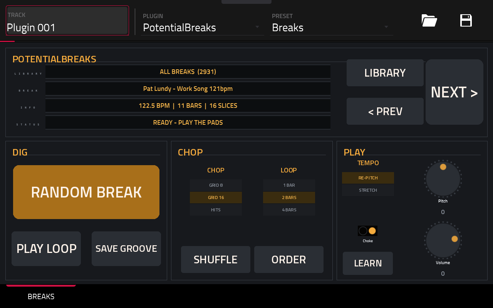
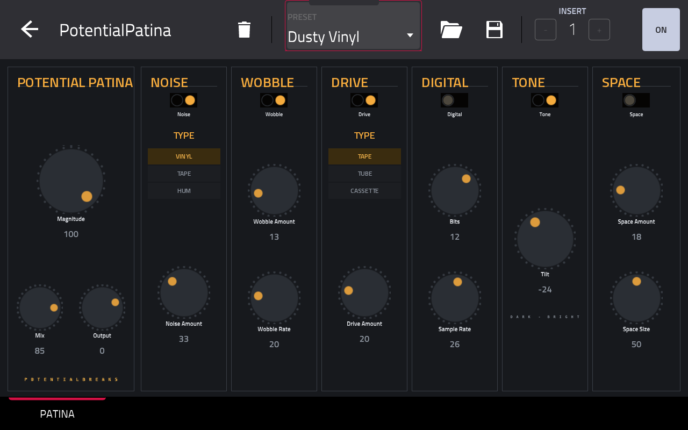

# Potential Plugins

Free plugins for **Akai MPC standalone hardware**, made by **PotentialBreaks** for my own beat-making and shared for anyone who wants them.

They run inside the MPC like its own instruments and effects. Each one has its own touchscreen page, works with Q-Links and saves with your project, with no computer needed while you play.

| Plugin | What it is | Latest |
|---|---|---|
| [**PotentialBreaks**](plugins/potentialbreaks/README.md) | Drum-break slicer: a random break from your own library on 16 pads, chopped and matched to your tempo | 1.1.1 |
| [**PotentialPatina**](plugins/potentialpatina/README.md) | Retro-colour insert effect: vinyl and tape noise, wobble, drive, bit-crush, tone and room in one box | 1.0.2 |

On the way: **PotentialWax**, a sampler for chopping melodic loops and whole songs.

| PotentialBreaks | PotentialPatina |
|---|---|
|  |  |

*Real screenshots from an MPC One.*

---

## Will it work on my MPC?

| | |
|---|---|
| **Tested on** | MPC One (first generation) with HAKAI 3.10 firmware |
| **Should work on** | Other first-generation (Gen1, 32-bit) standalone MPCs running **MPC OS 3.x**: One, Live, Live II, X |
| **Not yet** | Gen2 hardware (MPC One+, Live III, Key 37, XL and others): no build yet. **MPC OS 2.x**: not supported |
| **You need** | A way to install third-party plugins on your MPC (see below) |

The **Should work on** row is untested: these plugins have only been tried on one MPC so far. If you try one on another model, please [tell me how it went](../../issues/new/choose). That's how this table gets filled in.

---

## Install

**👉 [Step-by-step install guide](INSTALL-GUIDE.md)**: start here if it's your first plugin.

The short version:
1. Download the `-mpc-armv7.zip` from [**Releases**](../../releases) and leave it zipped.
2. Install it with the free **MPC Plugin Installer** from [Open MPC](https://open-mpc.github.io/): connect, drop the zip in, press Install. Or install over SSH (see the guide).
3. **Save your project first.** Installing restarts the MPC app.
4. Find **PotentialBreaks** in the plugin (instrument) list. **PotentialPatina** is an **insert effect**.

Stuck? The [**FAQ**](FAQ.md) covers the common problems.

---

## Things to know (limitations)

I'd rather you know these up front:

- **Made by one person, tested on one MPC.** They work well for me, but you may hit something I haven't. Please tell me if you do.
- **Gen1 only for now.** There's no build for Gen2 machines yet.
- **Plugins must be allowed to run on your MPC.** Stock firmware doesn't load third-party plugins until it has been set up for them (see [Open MPC](https://open-mpc.github.io/)). After a firmware update, you may have to redo that setup.
- **Each plugin's page lists its own limits.** See [PotentialBreaks](plugins/potentialbreaks/README.md#limitations) and [PotentialPatina](plugins/potentialpatina/README.md#limitations).
- **No warranty.** These are free and come as they are. Back up your projects. I can't be responsible for lost work.

---

## Ideas, bugs and criticism: all welcome

I make these for myself first, and I want them to be good for everyone else too, so **please tell me what you think**, including what you don't like.

- 💡 **Got an idea?** [Suggest a feature or a new plugin](../../issues/new?template=idea.yml).
- 🐛 **Something broken?** [Report a bug](../../issues/new?template=bug.yml).
- 💬 **Just want to say how it's going?** Any of the above is fine. Short messages are great.

You don't need to be technical. "The PITCH knob does nothing on my Live II" is a perfect bug report. See [CONTRIBUTING.md](CONTRIBUTING.md) for more, including how to send code.

---

## Credits

- Built on **[mpc-vst-plugins](https://github.com/sd88me/mpc-vst-plugins)** by sd88me (MIT), the open kit that makes MPC plugins possible: the plugin wrapper, skin builder and installer.
- Audio file reading by **[dr_libs](https://github.com/mackron/dr_libs)** (dr_wav and dr_flac) by David Reid (public domain / MIT-0).
- The look matches the dark theme I made for sd88me's Lucky Dip.
- Made with help from Claude (Anthropic).

Not affiliated with or endorsed by Akai Professional or inMusic. MPC is their trademark.

## Licence

[MIT](LICENSE): free to use, change and share, including in your own projects. Third-party parts keep their own licences ([THIRD_PARTY.md](THIRD_PARTY.md)).
