# Potential Plugins

Free plugins for **Akai MPC standalone hardware**, made by **PotentialBreaks** for my own beat-making and shared for anyone who wants them.

They run inside the MPC like its own instruments and effects. Each one has its own touchscreen page, works with Q-Links and saves with your project, with no computer needed while you play.

**📖 [The PotentialSuite manual](MANUAL.md)** ([PDF](PotentialSuite-Manual.pdf)): every plugin, the FX chains and their load orders, USER presets, and a developer reference at the back. Each plugin also has a **MANUAL** page on the MPC's screen.

**Each plugin has its own page with downloads, install steps and its FAQ. Click a name below.**

| Plugin | Type | What it is |
|---|---|---|
| [**PotentialBreaks**](https://github.com/PotentialBreakfast/mpc-vst-potentialbreaks) | Instrument | Drum-break slicer: a random break from your own library on 16 pads, chopped and matched to your tempo |
| [**PotentialWax**](https://github.com/PotentialBreakfast/mpc-vst-potentialwax) | Instrument | Melodic sampler: chop loops and whole songs onto pads, key and tempo matched |
| [**PotentialKits**](https://github.com/PotentialBreakfast/mpc-vst-potentialkits) | Instrument | Drum-kit builder: 16 sounds from your own sample folders, one-tap KIT STYLES and ROLL, pitch, decay and choke per pad, saved as an MPC drum program |
| [**PotentialCrates**](https://github.com/PotentialBreakfast/mpc-vst-potentialcrates) | Instrument | Record digger: one-tap crates and ROLL dice find records on Discogs and stream them into your track (needs a network connection) |
| [**PotentialPatina**](https://github.com/PotentialBreakfast/mpc-vst-potentialpatina) | Insert effect | Retro colour: vinyl and tape noise, wobble, drive, bit-crush, tone and room in one box |
| [**PotentialPunch**](https://github.com/PotentialBreakfast/mpc-vst-potentialpunch) | Insert effect | Transient shaper: more or less attack and sustain on drums, with presets |
| [**PotentialHeat**](https://github.com/PotentialBreakfast/mpc-vst-potentialheat) | Insert effect | Soft clipper and bus saturator: warmth and loudness without harsh peaks, with presets |
| [**PotentialWarp**](https://github.com/PotentialBreakfast/mpc-vst-potentialwarp) | Insert effect | Tempo-locked mangler: half time, tape stop, stutter, reverse and gates, with swing and triplets |
| [**PotentialGrit**](https://github.com/PotentialBreakfast/mpc-vst-potentialgrit) | Insert effect | Seven lo-fi effects on pads: dust, crush, filter, kill EQ, tempo echo, chop and ring mod |
| [**PotentialBleed**](https://github.com/PotentialBreakfast/mpc-vst-potentialbleed) | Insert effect | Ghost bleed: quiet synthetic residue behind each hit (snare wires, cabinet, piano board and more) |
| [**PotentialNoise**](https://github.com/PotentialBreakfast/mpc-vst-potentialnoise) | Instrument (mixing tool) | Calibrated pink-noise reference for balancing a mix, with test tones and a speaker check |

Punch and Heat are made to work together: Punch shapes the hit, Heat catches the peaks.

Also from me: **[MPC TOOLS](https://github.com/PotentialBreakfast/mpc-tools)**, a free second-screen app for Windows and Mac: your MPC's screen live on your PC (and in OBS), file transfer, your PC's folders on the MPC, one-click "save the last 60 seconds", the MPC's own buttons from the PC, one-tap plugin updates, and a one-tap drums-only folder made from every sample on the MPC.

| PotentialBreaks | PotentialWax | PotentialPatina |
|---|---|---|
| 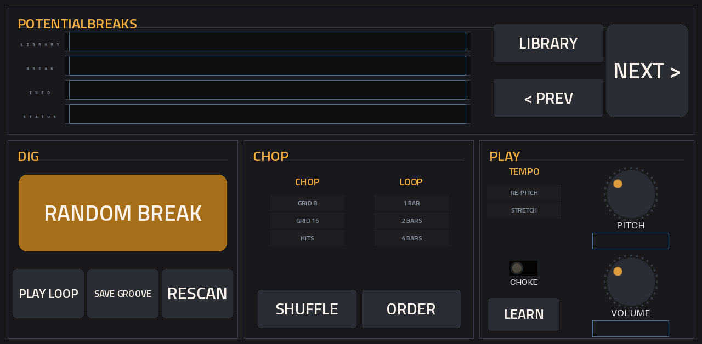 | 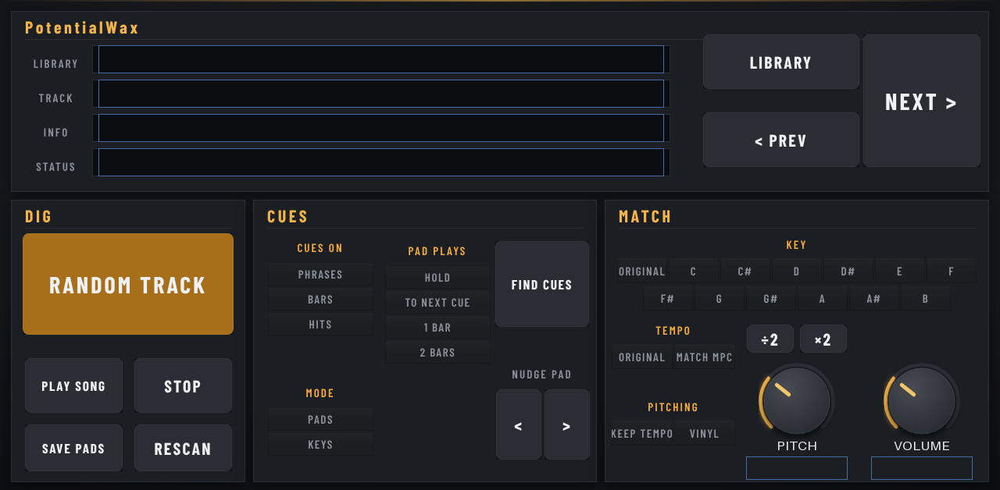 | 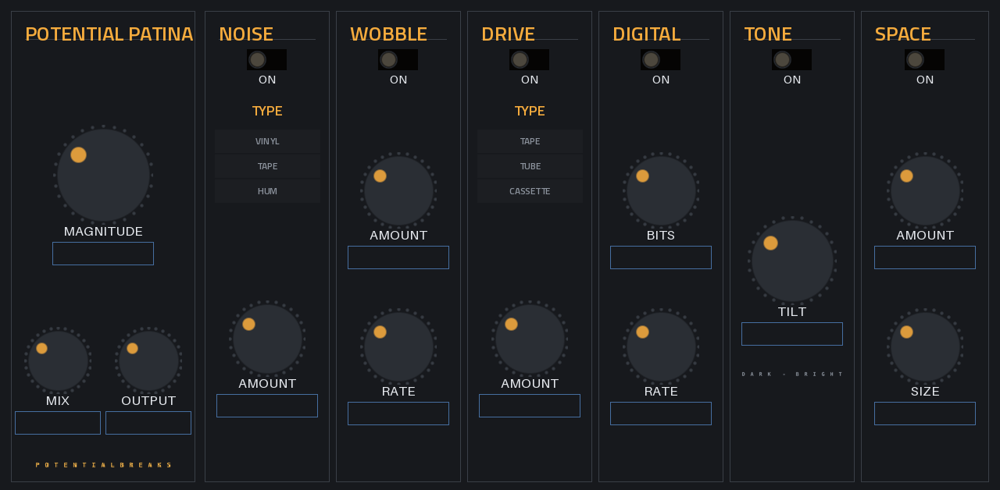 |
| **PotentialPunch** | **PotentialHeat** | **PotentialNoise** |
| 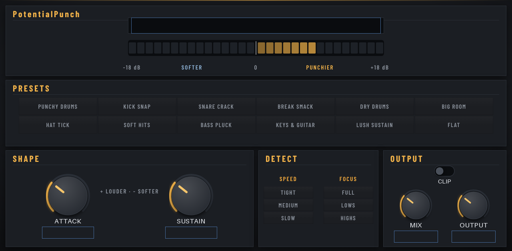 | 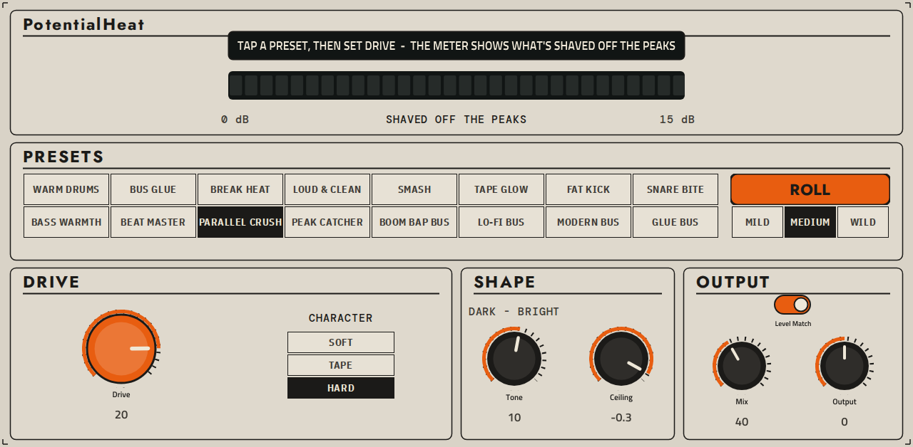 | 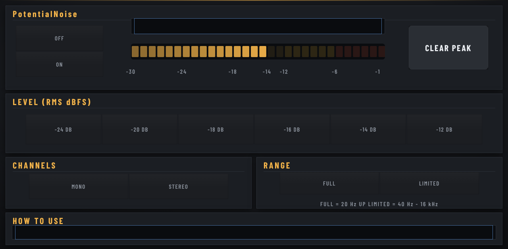 |
| **PotentialWarp** | **PotentialCrates** | **PotentialGrit** |
| 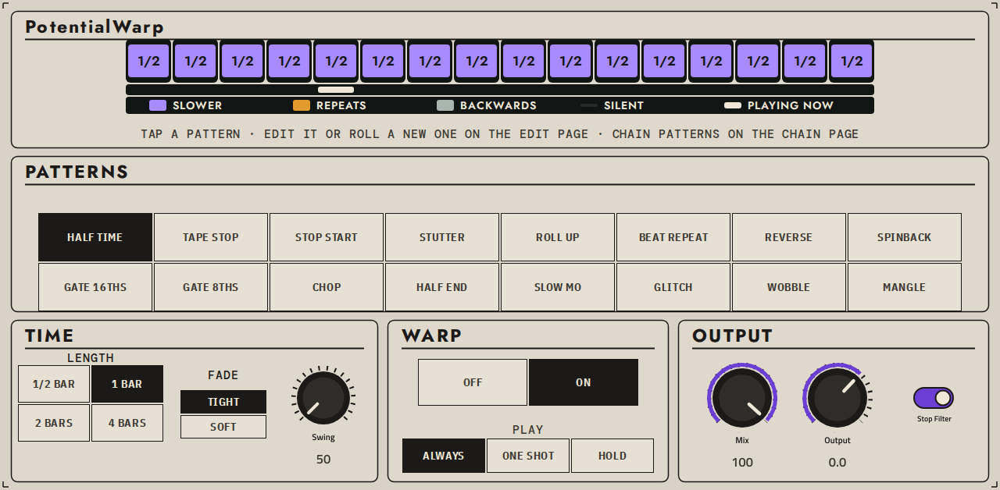 | 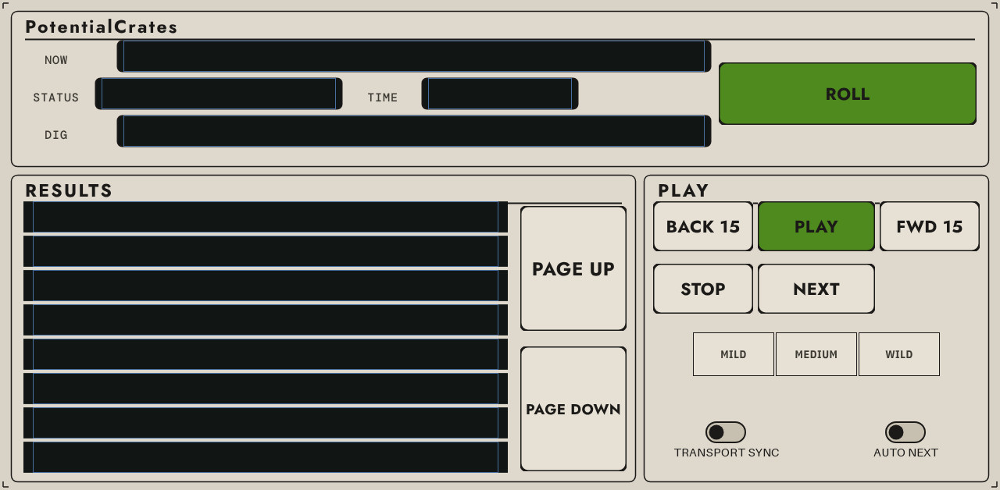 | 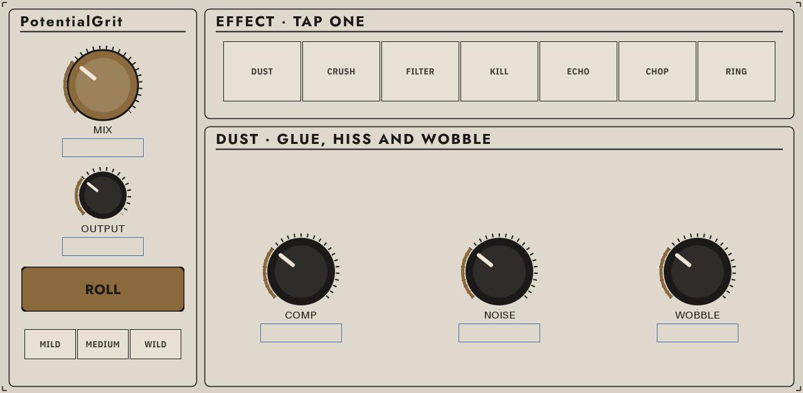 |
| **PotentialBleed** | **PotentialKits** | |
| 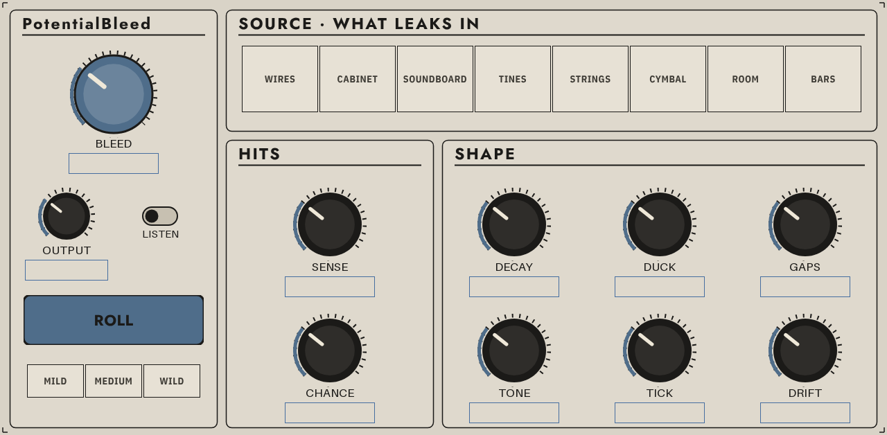 | 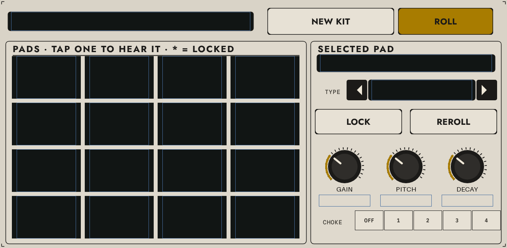 | |

*All in the Print Plate look. Every plugin also has Night Rack and Colour Block, switched on its SETTINGS page.*

---

## FX chains

Four ready-made chains. Put the plugins on a track's inserts in the order shown, then pick **the same preset name in each one**:
- **Patina, Grit and Bleed:** from the MPC's PRESET menu.
- **Punch:** from its own PRESETS buttons.

| Chain | For | Inserts, in order |
|---|---|---|
| **Dusty Loop** | soul, jazz and library loops | Bleed (SOUNDBOARD) → Patina ('60s 45) → Grit (FILTER, low pass ~4 kHz) |
| **90s Stab** | chopped horns, keys and vocal stabs | Grit (CRUSH, 12-bit ~26 kHz) → Punch → Bleed (TINES) → Patina ('90s CASSETTE) |
| **Break Bus** | a boom-bap drum bus | Punch → Grit (DUST) → Bleed (WIRES) → Patina ('70s TAPE) |
| **Dub Drums** | lo-fi dub drums | Patina ('80s SAMPLER) → Punch → Bleed (ROOM) → Grit (ECHO 1/8D) |

Dusty Loop doesn't use Punch. Every preset is a starting point, so tweak from there.

**Chains of your own:** Patina, Punch, Heat, Grit and Bleed each have a **USER** page with 8 slots. Tap **SAVE**, then a slot, in each plugin, using the same slot number. To bring the chain back, add the plugins in the same order and tap that slot in each. The [manual](MANUAL.md#6-working-together-fx-chains) has the step-by-step.

Rules of thumb:
- **Punch early**, so the hits are shaped before compression, crushing or tape.
- **Bleed before Patina**, so the bleed is aged with the sound instead of pasted on top.
- **Echo and chop last.**
- **One noise source per chain.**
- **Match levels with OUTPUT** before you decide.

## Will it work on my MPC?

| | |
|---|---|
| **Tested on** | MPC One (Gen1) on HAKAI 3.10 and on MPC OS 3.10.1 with Akai's plugin folder. PotentialWax also on an MPC Live; PotentialPatina, PotentialPunch and PotentialWax also on an MPC Key 37 (MPC OS 3.10.1) |
| **Should work on** | Any standalone MPC on **MPC OS 3.10.1 or later**, 32-bit and 64-bit. Also Gen1 MPCs on older MPC OS 3.x with the community set-up |
| **Not supported** | **MPC OS 2.x** |

The **Should work on** row is untested: most of these plugins have only been tried on a few MPCs so far. If you try one on another model, please [tell me how it went](../../issues/new/choose). That's how this table gets filled in.

---

## Install

**👉 [Step-by-step install guide](INSTALL-GUIDE.md)**: start here if it's your first plugin.

The short version (the [manual](MANUAL.md#2-getting-started) has all three ways):
1. **MPC OS 3.10.1 or later:** open the plugin's page (table above), download its `-akai-vst2.zip` from **Releases** and unzip it. On the MPC turn on **Preferences → Enhancements (Beta) → Enable Enhancements** and **External Plugin Support**, copy the plugin's folder into **VST2 Plugins** at the top of a drive, and restart.
2. **Or with [MPC TOOLS](https://github.com/PotentialBreakfast/mpc-tools):** the Plugins tab installs and updates all eleven in one tap.
3. **Older MPC OS 3.x (Gen1):** download the `-mpc-armv7.zip` and install it with the free **MPC Plugin Installer** from [Open MPC](https://open-mpc.github.io/). Save your project first.
4. Breaks, Wax, Crates, Kits and Noise are in the plugin instrument list (load them as a plugin program). Patina, Punch, Heat, Warp, Grit and Bleed are **insert effects**.

Stuck? The [**FAQ**](FAQ.md) covers the common problems.

---

## Things to know (limitations)

I'd rather you know these up front:

- **Made by one person, tested on a few MPCs.** They work well for me, but you may hit something I haven't. Please tell me if you do.
- **Gen2 builds are new.** Every plugin has a 64-bit build that passes Akai's own checks, but few have been tried on a Gen2 MPC yet.
- **Plugins must be allowed to run on your MPC.** On MPC OS 3.10.1 or later, switch on External Plugin Support. Older firmware doesn't load third-party plugins until it has been set up for them (see [Open MPC](https://open-mpc.github.io/)). After a firmware update, you may have to do that again.
- **Each plugin's page lists its own limits.**
- **No warranty.** These are free and come as they are. Back up your projects. I can't be responsible for lost work.

---

## Ideas, bugs and criticism: all welcome

I make these for myself first, and I want them to be good for everyone else too, so **please tell me what you think**, including what you don't like.

- 💡 **Got an idea?** [Suggest a feature or a new plugin](../../issues/new?template=idea.yml).
- 🐛 **Something broken?** [Report a bug](../../issues/new?template=bug.yml).
- 💬 **Just want to say how it's going?** Any of the above is fine. Short messages are great.

You don't need to be technical. "The PITCH knob does nothing on my Live II" is a perfect bug report. See [CONTRIBUTING.md](CONTRIBUTING.md) for more, including how to send code.

---

## Credits

- Built on **[mpc-vst-plugins](https://github.com/sd88me/mpc-vst-plugins)** by sd88me (MIT), the open kit that makes MPC plugins possible: the plugin wrapper, skin builder and installer.
- PotentialGrit is inspired by DustBox (6teen Levels) and PotentialBleed by Ghost Sample (16 Levels). Both are independent designs with their own code.
- PotentialKits is a fork of **[Lucky Dip](https://github.com/sd88me/mpc-vst-luckydip)** by sd88me (MIT): his kit-building engine, with KIT STYLES, ROLL, pitch, decay and choke, USER kits and the PotentialSuite looks added.
- PotentialCrates is a fork of **[Crate Digger](https://github.com/sd88me/mpc-vst-cratedigger)** by sd88me, with its streaming engine built on Charles Vestal's [schwung-webstream](https://github.com/charlesvestal/schwung-webstream) (both MIT).
- Audio file reading by **[dr_libs](https://github.com/mackron/dr_libs)** (dr_wav, dr_flac and dr_mp3) by David Reid (public domain / MIT-0).
- The look matches the dark theme I made for sd88me's Lucky Dip.
- Made with help from Claude (Anthropic).

Not affiliated with or endorsed by Akai Professional or inMusic. MPC is their trademark.

## Licence

[MIT](LICENSE): free to use, change and share, including in your own projects. Third-party parts keep their own licences ([THIRD_PARTY.md](THIRD_PARTY.md)).
