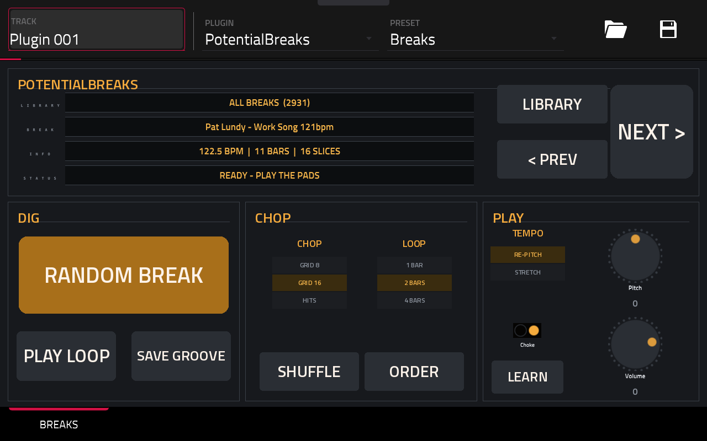

# PotentialBreaks

**Dig, chop, play.** Tap one button for a random drum break from your own library. It's sliced across 16 pads and matched to your project's tempo, ready to flip.

*Instrument plugin · MPC OS 3.x · Gen1 (32-bit) · v1.1.1*

## What it does

- **RANDOM BREAK** picks a break from your library. **PREV** and **NEXT** step through them, and **LIBRARY** switches folders.
- **Long tracks** (a whole drum-library track, say) get a random 1, 2 or 4 bar loop cut from them, starting on a hit. Short files are used as they are.
- **Tempo** comes from the file name when it has one (`Funky Drummer 101bpm.wav` or `... 96 BPM.wav`). Otherwise it's measured.
- **CHOP** gives you 8 even slices, 16 even slices (moved onto the nearest hit), or the 16 strongest hits.
- **TEMPO** has two modes:
  - **Re-pitch** speeds the break up or slows it down to your tempo, like an old sampler.
  - **Stretch** keeps each slice at its own pitch and cuts it to length, the classic chopped-break method.
- **SHUFFLE** re-deals the slices across the pads, and **ORDER** puts them back.
- **PLAY LOOP** (or the pad after pad 16) plays the whole loop.
- **SAVE GROOVE** writes a MIDI file of the break's original slice order, so you can load it into a sequence and start from the real groove.
- **CHOKE**, **PITCH** (±12 semitones) and **VOLUME** are here too.
- Your project remembers the break, the chop, the pad order and the settings.

## Where it finds your breaks

You don't have to type any paths. It looks in three places:

1. **A folder called `DRUM BREAKS LIBRARY`** at the top of any drive (SD card, USB drive or SSD).
2. **Any folder at the top of a drive with "break" in its name**, such as `My Breaks` or `Breakbeats`.
3. **Folders you list yourself** in `PotentialBreaks/folders.txt`. The plugin creates this file on your breaks drive the first time it runs, with instructions inside. Put one folder per line, either a full path or a folder on that drive.

Every sub-folder becomes a **library** you can step through with LIBRARY. Files lying loose in a folder make a library of their own. After adding folders, tap **RESCAN**.

WAV and FLAC files are supported.

## Playing it from the pads

The pads play **MIDI notes 36–51** (and 0–15). If pad 1 doesn't play the first slice on your MPC, tap **LEARN** and then hit the pad you want as pad 1. The STATUS line shows the last note received, which helps with setup.

## Limitations

- **Only the first 3 minutes of a file are used.** This keeps the MPC's memory safe on huge files.
- **The tempo guess for unnamed files is 80–160 BPM.** A 70 BPM break may read as 140. Putting the BPM in the file name avoids this.
- **Stretch mode doesn't time-stretch.** Slices keep their pitch, so at a slower tempo you'll hear small gaps between hits. That's the classic sound, but it isn't a smooth stretch.
- **The automatic chop is a best guess.** On busy or swung breaks some slices may not land exactly on a hit. Try another CHOP mode.
- **8 voices**, and only 44.1 kHz playback.
- **The pads map like a keyboard.** The MPC treats a plugin track like a keyboard, so with some pad bank or octave settings pad 1 isn't note 36. LEARN fixes this.
- **SAVE GROOVE** writes to the first drive your breaks are on, in a `PotentialBreaks` folder.
- **Tested on an MPC One only**, and on Gen1 hardware only.

## Install

See the [step-by-step install guide](../../INSTALL-GUIDE.md). Problems? Check the [FAQ](../../FAQ.md). Download `PotentialBreaks-<version>-mpc-armv7.zip` from [Releases](../../releases).

## Build it yourself

See [BUILD.md](BUILD.md).
