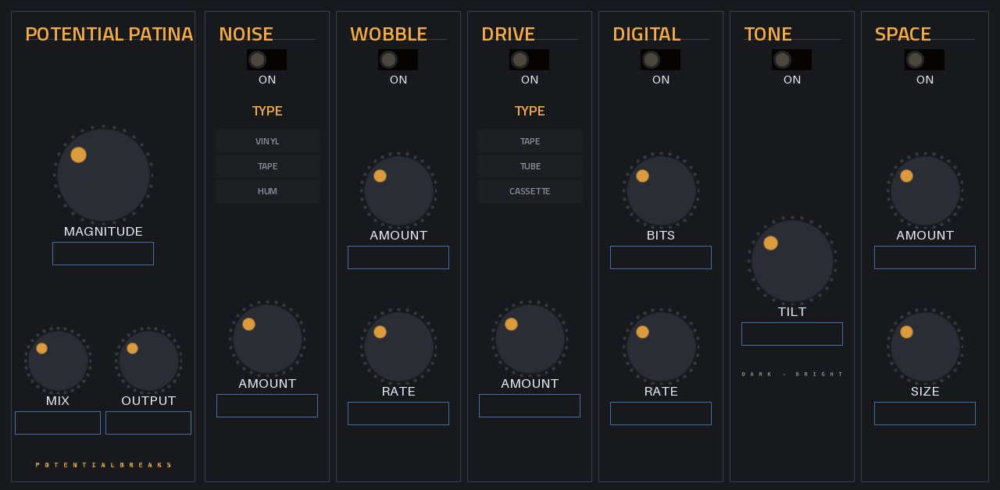

# PotentialPatina

**Instant character.** A retro-colour box for any track: vinyl crackle, tape hiss and wobble, warm drive, bit-crushing, tone and a small room, all set with one big **MAGNITUDE** knob.

*Insert effect · MPC OS 3.x · Gen1 (32-bit) · v1.0.2*

Inspired by the "retro colour" style of plugin made popular on computers. Not affiliated with any of them.

## What it does

| Section | What it adds |
|---|---|
| **MAGNITUDE / MIX / OUTPUT** | Fade the whole effect in and out, blend it with the dry sound, set the level |
| **NOISE** | Vinyl crackle, tape hiss or mains hum |
| **WOBBLE** | Tape wow and flutter (pitch drift) |
| **DRIVE** | Tape, tube or cassette saturation, level-matched so it doesn't just get louder |
| **DIGITAL** | Bit depth and sample-rate reduction, for the old-sampler crunch |
| **TONE** | One dark–bright tilt knob |
| **SPACE** | A small room |

Each section has its own **ON** switch.

**Presets:** Patina, Dusty Vinyl, Worn Tape, Cassette Demo, 12-bit Sampler, Crunchy 8-bit, Old Radio, Basement Room and Clean. They're set fairly subtle, so turn MAGNITUDE or the section knobs up for more.

## How to use it

Add it as an **insert effect** on a track, program, pad or bus. It won't be in the instrument list. Start with a preset, then use MAGNITUDE to set how much.

## Limitations

- **About 7 ms of delay** while it's switched on, because of how the wobble works. It's rarely noticeable, but it can be on tight layered drums.
- **Stereo in, stereo out**, at 44.1 kHz.
- **CPU use on the MPC hasn't been measured yet.** Several copies at once, especially with SPACE on, may be a lot for a Gen1 MPC.
- **Tested on an MPC One only**, and on Gen1 hardware only.

## Install

See the [main page](../../README.md#install). Download `PotentialPatina-<version>-mpc-armv7.zip` from [Releases](../../releases).

## Build it yourself

See [BUILD.md](BUILD.md).
